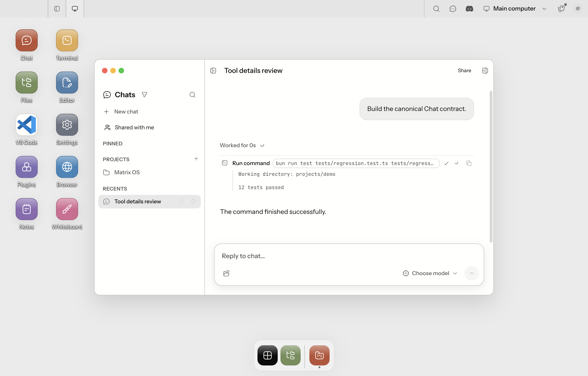

# Chat tool display and replay

Codex tool lifecycle records must retain their identity even when optional
preview text cannot be displayed. A plaintext command preview uses the thread event's
1,000-character/4,000-byte bound; working-directory detail uses its
2,000-character/8,000-byte bound. Neither field is a 120-character tool label.
Rejected optional metadata is omitted independently. An incomplete preview/kind
pair is omitted together, without discarding the start event.

Complete Codex commands, including absolute owner VPS paths and multiline shell
snippets, use an optional encrypted `protectedPreview`. It reuses the runtime's
existing owner key with a distinct `matrix-tool-preview:v1:<toolCallId>`
authentication purpose; result ciphertext cannot be replayed as a command.
Recognized credential assignments, headers, flags and values suppress the
command rather than publishing them. A filename such as `.env`, `auth.json`, or
`id_rsa`, or a `token` identifier alone, is not a credential value. Command
contents use the existing encrypted envelope bound of 4,000 UTF-16 units /
16 KiB UTF-8 bytes. Commands beyond that cap or with invalid controls omit
optional command evidence while retaining tool identity and status. Plaintext
legacy previews remain capped at 1,000 characters / 4,000 bytes; a longer
command is retained only as protected owner content.

Only an authenticated matching personal Chat owner who is also the configured
VPS owner may open a command preview. Shared/non-owner responses, exports and
legacy thread HTTP/WebSocket copies strip the preview sidecar; shared reads
continue to redact private paths. Missing or invalid keys retain safe coarse
metadata. New canonical clients opt into `commandPreviewVersion=1` for complete
previews; unversioned responses retain the legacy safe preview contract.

Provider ingestion, including Claude and Hermes tool projections, retains the
strict plaintext preview contract. The wider owner response schema must never
admit raw private commands: only the authenticated encrypted sidecar may supply
them. Read, export and legacy thread projections also apply the coarse policy
to historical unprotected metadata before any authorized owner decryption.

Native completion metadata enriches the existing activity ID instead of
emitting another start, so status, activity sequence and watchdog accounting
remain stable. Detail expansion shows all command lines alongside the working
directory and result; Electron Desktop's copy action preserves the exact
command. Previously discarded commands cannot be reconstructed.

All arbitrary tool result text is **private owner content**, including text that
contains no recognizable secret marker. A denylist cannot prove a string safe.
The detached Codex runner seals bounded results with AES-256-GCM before writing
the journal. Hermes uses the same sealing path before yielding a provider event.
The tool call ID is authenticated as associated data; tampering, a different
identity or a different key fails closed. General `tool.output.text` remains a
coarse notice, while `protectedOutput` carries only a bounded encrypted envelope.
This applies equally to terminal, file-read and MCP text envelopes. Arbitrary
objects and binary content are never serialized.

The per-runtime 32-byte key is owner configuration under
`system/.tool-output.key`, created exclusively with mode 0600 and no temporary files. Bounded retries
handle concurrent incomplete writes; partial keys are never used. Concurrent startup
and gateway/runner restarts reuse the same key. Symlink keys, invalid lengths,
other-user ownership and group/world permissions are rejected. The key must be
preserved with owner configuration during backup/recovery; losing it leaves old
results unavailable. Missing, unreadable or invalid keys degrade new results to summaries with a
coarse server-side warning; they do not abort Gateway or runner startup. A key
left incomplete by a crash requires operator repair and is never overwritten.
No key or plaintext result is placed in the provider event or database outbox.

Only the authenticated personal-owner Chat detail response and content stream
may decrypt. They require both matching Chat ownership and the configured VPS
owner, reject shared Chats, and never mutate repository/outbox objects. Legacy
thread views, generic event consumers, telemetry, collaboration and share
snapshots do not decrypt. Share snapshots select user/assistant text only, not
activities. This does not prevent an assistant/user from deliberately quoting
content in a message; message sharing remains an explicit separate action.
Known credential/path patterns and sensitive command context are still withheld
as defense in depth, but are not the privacy boundary. The authorized owner can
see unmatched opaque private content; this is not a public-safe text guarantee.
Host/process compromise and an owner reading their own runtime key are outside
this boundary. No new cross-owner filesystem or provider authority is granted.

Output remains capped at 4,000 UTF-16 units / 16 KiB and reports truncation.
Hermes retains only the tool name and a private-context bit across
start/completion frames, including when completion omits its name/arguments.
Unknown envelopes remain summary-only. Unencrypted historical output is not
backfilled or represented as retroactively encrypted by this change. Old detached
runner events are reduced to allowlisted coarse notices at ingestion and the
canonical adapter; only sealed envelopes retain actual output across replay.

Canonical activities remain the source of truth for live delivery and reload.
Renderers combine working-directory/status detail with tool output instead of
letting one hide the other, cap expanded detail at 16,000 characters, and mark
truncation. Web Canvas, Web Desktop and Web Mobile share the Web Chat component;
Native Mobile shares the activity projection and offers a bounded expandable
result. Electron Desktop retains its existing activity presentation and copy
command action. The legacy project transcript now displays its validated command
preview and working directory, while retaining its payload-free output summary.

Existing consecutive-tool grouping remains in place. This fix does not introduce
new grouping rules, expose arbitrary raw argument objects, or reconstruct data
that an older runner/parser already discarded. It does not change execution,
authorization, database ownership, or share/export visibility rules.

## Authorization and persistence checks

| Path | Required identity | Result handling |
| --- | --- | --- |
| Personal Chat detail | Authenticated matching Chat owner and runtime owner | Decrypt response copy only |
| Personal content stream, live/replay | Same owner checks after stream authorization | Decrypt frame copy only |
| Wrong owner, shared Chat | No private output grant | Coarse notice |
| Journal, Postgres activities, outbox | Runtime write authority | Ciphertext and coarse notice |
| Share snapshot, telemetry, legacy thread | No private output grant | No decryption |

## Regression checks

- `tests/gateway/protected-tool-output.test.ts`: opaque text, authenticated
  encryption, concurrent key creation and restart key reuse.
- `tests/gateway/owner-tool-output.test.ts`: owner/wrong-owner/shared boundaries,
  live/replay delivery, and unchanged encrypted repository/outbox/telemetry.

- `tests/gateway/codex-tool-display-contract.test.ts`: long commands, long
  directories, malformed/unsafe optional fields and multiline results.
- `tests/gateway/codex-tool-output.test.ts`: safe text, private context and size
  bounds before journal persistence.
- `tests/gateway/chat-coding-provider.test.ts`: live and snapshot replay retain
  output through the canonical adapter.
- `tests/gateway/coding-agents-codex-app-server-reliability.test.ts`: a spawned
  detached runner journals a long command and its result, then replays both.
- `tests/desktop/chat-tool-output-parity.test.ts`: desktop/web/mobile projection
  retains preview, metadata, result and truncation after serialization/reload.
- `tests/shell/tool-call-details.test.tsx` and Native Mobile
  `__tests__/chat-tool-activity.test.tsx`: expandable output and status.
- `tests/e2e/desktop/chat-tool-details.e2e.test.ts`: built Electron Desktop with
  a disposable profile and synthetic gateway; open Chat, select Tool details
  review, expand Worked for and Run command, then repeat after reload.

For the Electron check, build with `bun run build:desktop`, then run
`MATRIX_DESKTOP_E2E_REQUIRED=1 pnpm exec vitest run --config vitest.e2e.config.ts tests/e2e/desktop/chat-tool-details.e2e.test.ts`.
Evidence is written to `output/chat-tool-details/`; the disposable profile and
gateway are cleaned up after the test. This fixture check is not a production
provider call or human approval.

## Current visual evidence

Built Electron Desktop, synthetic owner Chat: expanded long command, working
directory and result after reload. This is the user-prioritized surface. Native
Mobile physical-device acceptance remains deferred; its interaction regression
is covered by the component test, not represented as device acceptance.

Pi and OpenCode retain their existing thread event/journal contracts. When their results enter canonical Chat, the shared coding adapter seals them with the runtime key before canonical activities and outbox persistence; missing keys leave coarse notices. Their pre-existing thread journals are outside this output-protection boundary. Legacy unsealed Codex output remains coarse because Codex sealing belongs before journal persistence.

## Managed Matrix Pi (ENG265 follow-up)

`matrix_pi` uses `managed-pi-runtime` and the pinned bot worker, not the native
Pi CLI collector. The internal broker's optional `tool_progress.display`
selects a tool name, known scalar input fields, an allowed command and recognized
text blocks. It never forwards raw argument/result objects, binary content or
model thinking. Gateway ingestion rechecks evidence and seals parameters and
output with the existing owner key before canonical activity/outbox writes.
Command evidence uses `protectedPreview`; selected parameters and result use
`protectedOutput`. Private parameter paths are filtered independently, so they
cannot hide an otherwise displayable result. Known credential context/results
remain withheld even from the owner; absent keys retain coarse notices.

Start, update and completion use the same toolCallId/activityId. Managed Pi
`tool.output` entries are authoritative display snapshots; projections select
the latest one rather than concatenate partial and final results. Codex/Claude
retain append semantics. Worker tracking is capped at60 tools per turn, three
updates per tool at least250ms apart, 750 characters of selected input, 3,000
characters of result and 4,000 characters of command. Gateway repeats tool/update
caps. The global event budget reserves a terminal slot for every tracked tool.
Canonical retention remains500 records; full tool snapshots do not grow without
bound. Snapshot replacement preserves parameters alongside the current result.

Cancellation keeps the existing orchestrator rule rejecting late provider
output. Pending managed cards derive stopped/failed/partial from the canonical
Run when it is aborted/failed/completed, including after reload; explicit tool
terminal states remain unchanged. Missing end events never imply success.
Empty text, unavailable/unknown envelopes, hidden sensitive output and truncated
output have separate notices. Historical payload-free events remain supported;
previously discarded details cannot be reconstructed.

SDK partial results and supported Custom MCP progress notifications update the
same managed card. For MCP the existing authorized POST opts into a bounded
NDJSON response: the pinned HTTPS requester parses complete SSE notifications
from that same upstream call, RemoteMcpClient matches a unique per-call progress
token, and owner tools encrypt the selected progress text before canonical
persistence. There is no additional execution, reconnect retry or receipt
consumption. Non-stream callers retain JSON behavior. Cancellation aborts this
request without evicting a remote session shared by other invocations. Late or
foreign updates are ignored. Three updates are sampled per call; the last
snapshot announces that live updates paused until completion. The final result
retains its own192KiB transport limit, with a separate bounded allowance for
three progress frames and framing overhead.

MCP progress messages describe service-provided progress; they are not an
implicit stdout/stderr contract. Artifact and ordinary integration tools still
return final results. No local shell executor or arbitrary server log feed is
added. A producer returning final content only cannot show real intermediate
output. Actual stdout acceptance needs a specifically identified producer
that supplies those frames; fixture notifications cannot establish it.
Broker-encoded MCP results reveal recognized text content and isError only;
details/structuredContent are not serialized into the display. This changes
display status without changing the model's execution result or approval rules.
Private Preview and local Electron acceptance precede HumanReview; Greptile and
formal CI follow user acceptance. Live evidence is still required separately.
