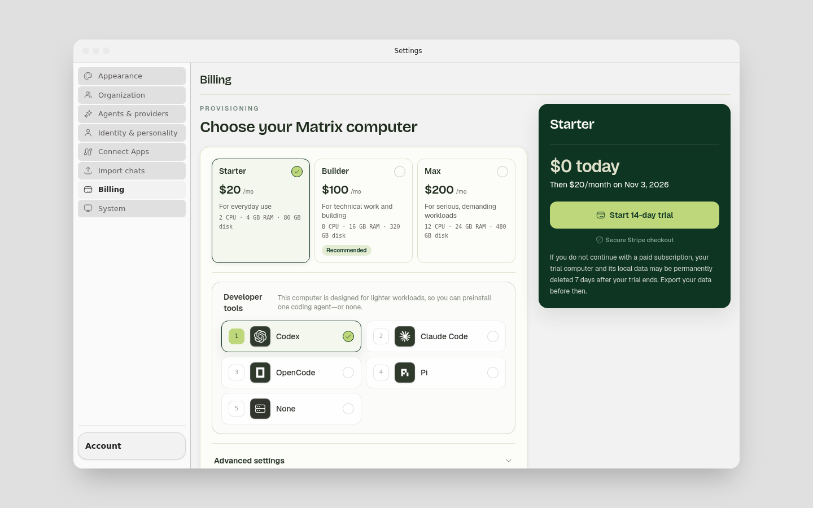
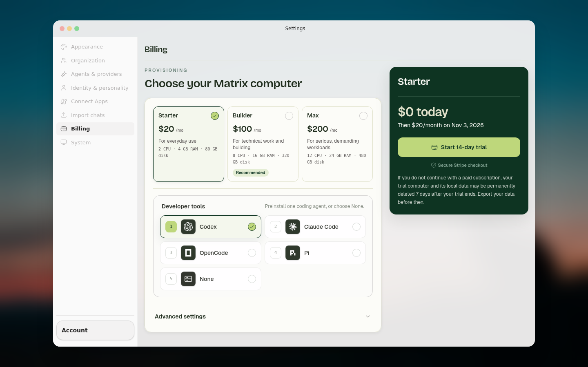
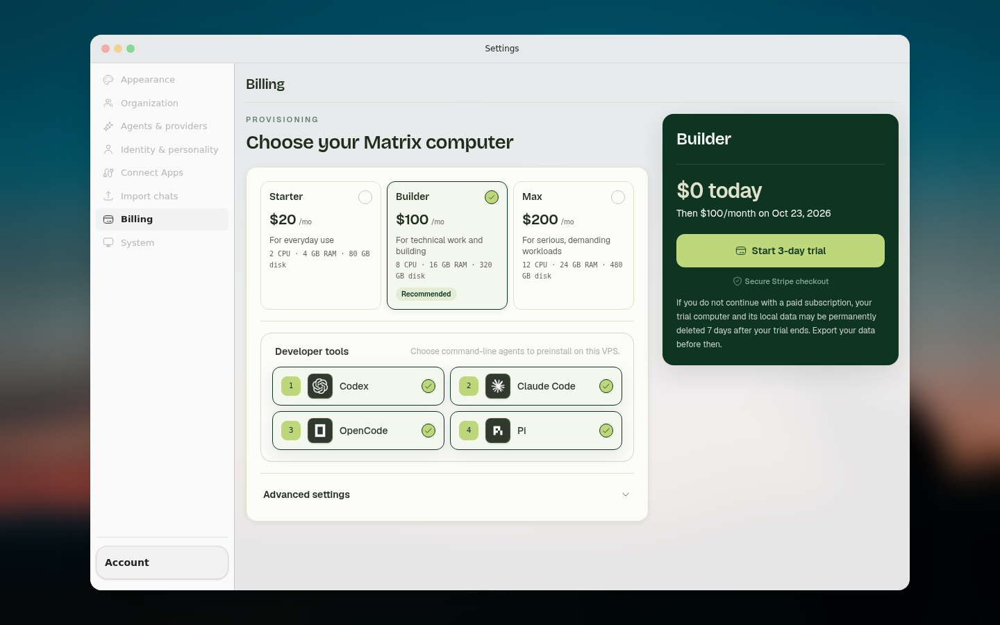
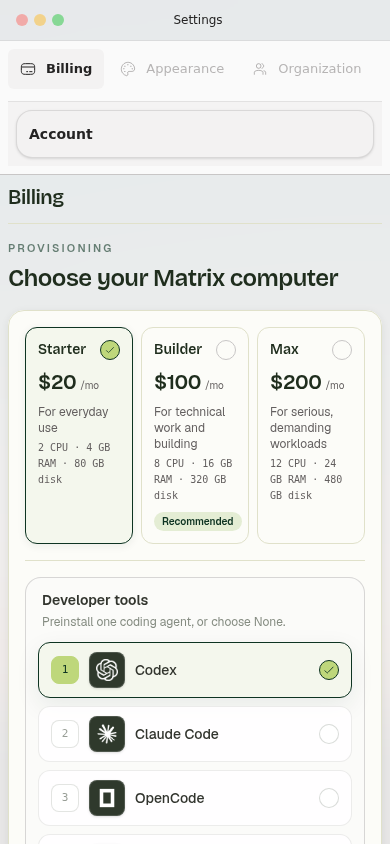
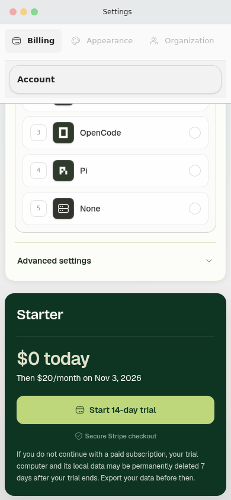
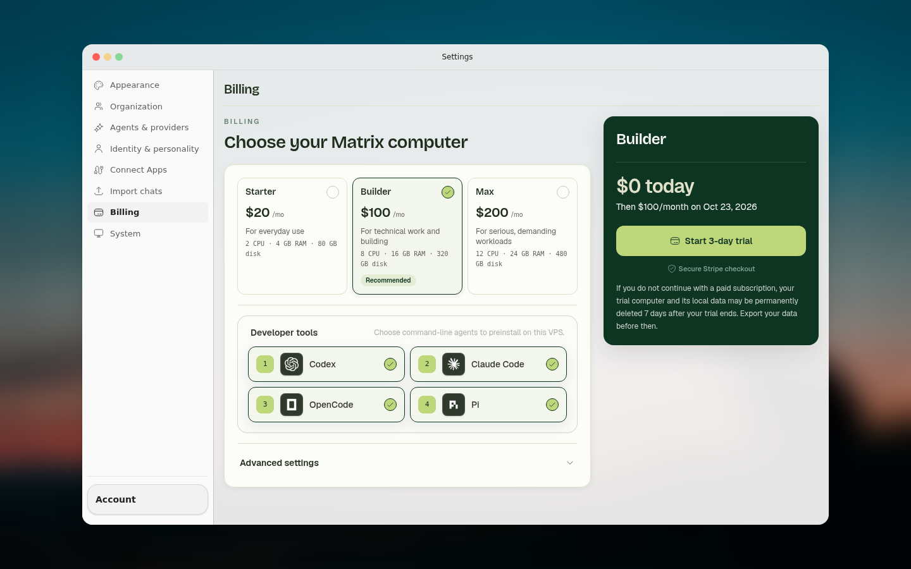

# Billing setup design regression

The October 19 theme-defaults change (#2420, `de11fa163`) applied a muted
background with `!important` to **every** disabled button. Settings uses disabled
native buttons for its locked navigation, window controls and full-screen
backdrop. The rule therefore painted opaque gray rectangles over those surfaces.

The fix limits that treatment to the shared filled form-button variants.
Locked billing setup also supplies the existing onboarding wallpaper explicitly,
leaves room for Starter's fifth agent choice, and uses a single-column agent
list when the selector's own container is narrow. Normal Settings keeps its
existing backdrop and navigation behavior.

## Rendered evidence

| Before (1440 × 900) | After (1440 × 900) |
| --- | --- |
|  |  |



| Mobile plans (390 × 844) | Mobile checkout after scrolling |
| --- | --- |
|  |  |



## Verification boundary

These are Chromium screenshots of the production `OnboardingGate`, `BillingGate`,
`Settings`, billing status hook, selectors and checkout components, with the
production stylesheet, fonts and images. The browser runs at `?plans=1`; it does
not use the application's E2E billing bypass.

Authentication, the account footer, unrelated Settings destinations and the
underlying boot screen are fixture seams. Billing HTTP responses are synthetic;
external requests are blocked. No real account, payment, provisioning, or
Electron application was exercised. The current server-provided fixture offers
are 14 days for Starter and 3 days for Builder/Max; this PR does not change them.

The browser suite checks:

- Computed navigation/background colors in first-paint and flat themes, plus
  retained disabled styling for form controls.
- Wallpaper loading, complete desktop content, and a one-line tools heading.
- Starter radio/None behavior, Builder multi-select, plan-specific trial copy,
  Advanced settings, and recovery after a simulated checkout error.
- No page-level horizontal overflow and reachable checkout at 390 × 844 and
  1024 × 768.
- Regular Settings retains enabled navigation/close controls and does not add
  an onboarding wallpaper.

Run from the repository root:

```sh
pnpm exec vitest run --config vitest.e2e.config.ts tests/e2e/billing-setup-design.e2e.test.ts
```

Set `PLAYWRIGHT_CHROMIUM_EXECUTABLE` if using an already installed Chromium.
Generated captures live in ignored `output/playwright/billing-setup/`; only the
reviewed images above are retained in version control.
