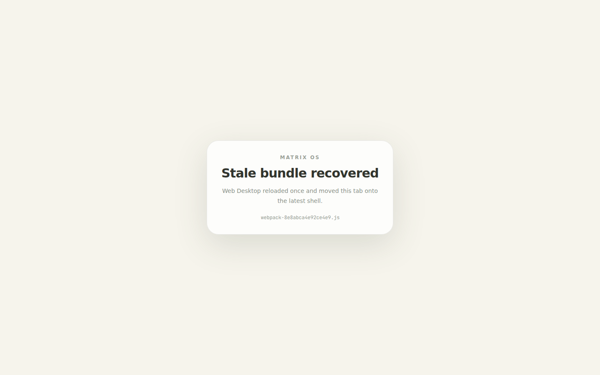

# ENG-425 Web Desktop evidence

Captured on 2026-11-02 from implementation commit
`4b982f08ed84972aa24ef77022bcecc66adac515`.

## Scenario and assertions

- Surface: Web Desktop platform auth shell, 1440x900 Chromium, Next.js 16.4.1
  webpack development runtime.
- Fixture: the development-only `/error-preview?kind=stale-bundle` route throws
  Valerie's production failure shape, including runtime
  `webpack-8e8abca4e92ce4e9.js` and chunk `4913-33f6c7c99102b8d7.js`.
- Browser result: `performance` reported navigation type `reload`; session
  storage held the versioned, matching one-shot claim; the recovered shell
  rendered; Playwright observed zero page errors.
- Test controls: `E2E_TEST_BYPASS=1` and `NEXT_PUBLIC_E2E_TEST_BYPASS=1` skipped
  customer authentication, and PostHog keys were blank. No customer data or
  credentials were used.

## Scope and limitations

This is a live local Web Desktop capture of the changed production error
boundaries and recovery helper under a deterministic stale-chunk fixture. It
does not claim a deployed Cloud Run rolling-revision exercise. Web Canvas, Web
Mobile, Electron Desktop, and Native Mobile are not separate affected surfaces:
the incident occurs in the platform-owned browser auth shell before an OS view
or native shell is selected. The preview route returns 404 in production.

PNG SHA-256:
`02527443671f897617ee88bbb019093cb63229d38c724b62e45d1adc3012d659`.
