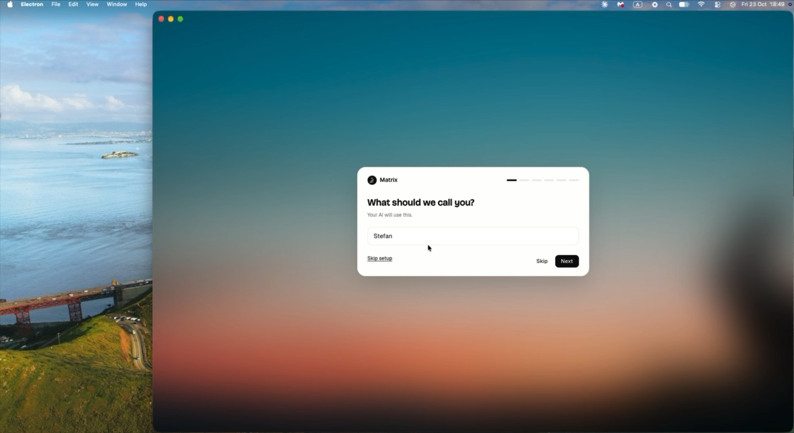
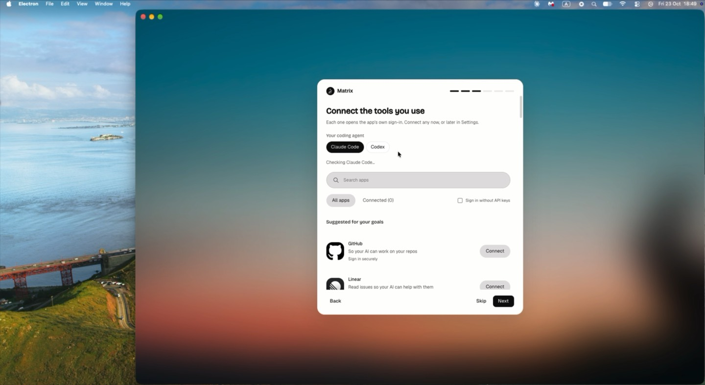
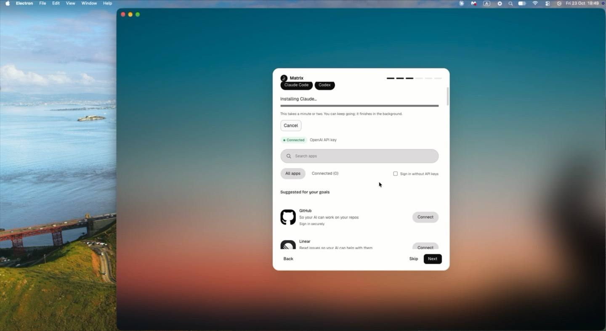
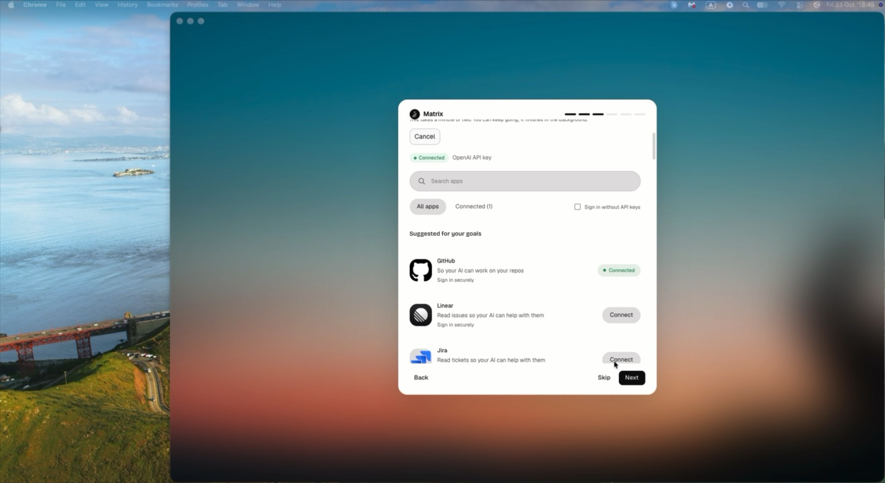
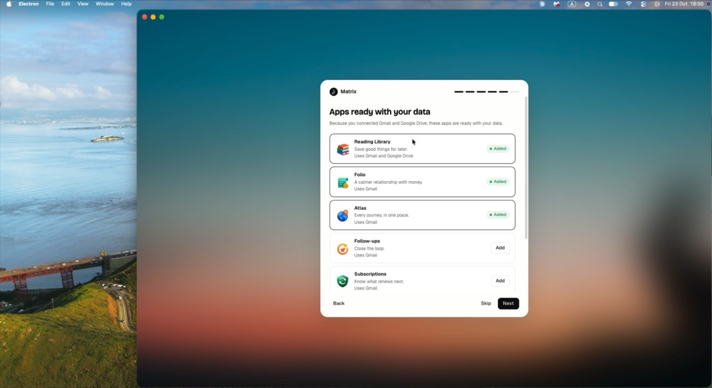
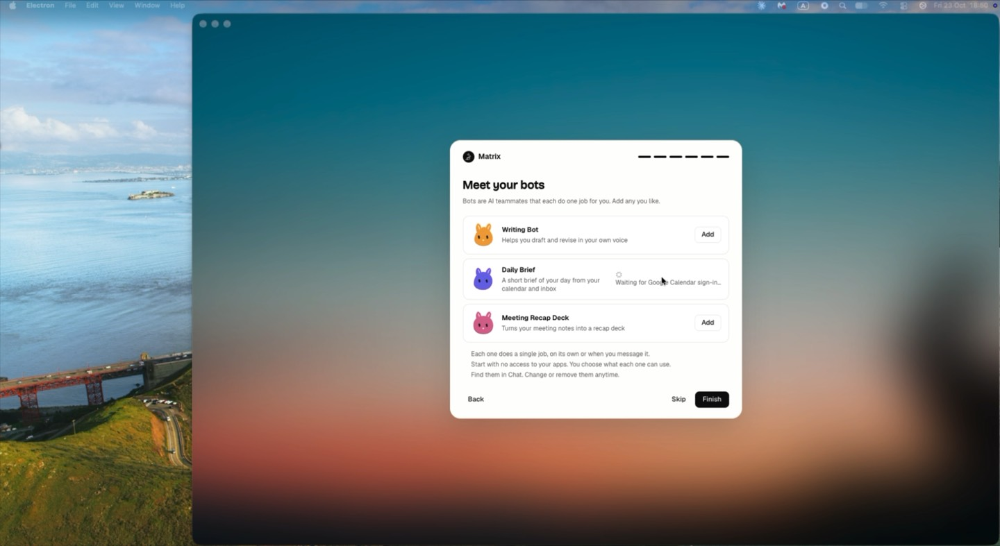
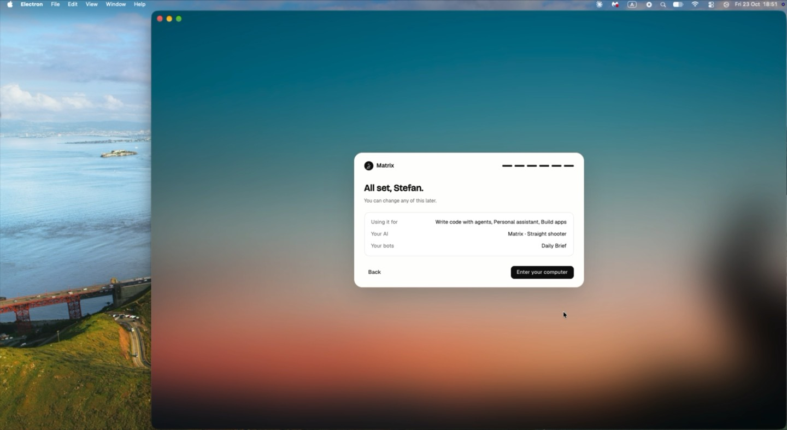
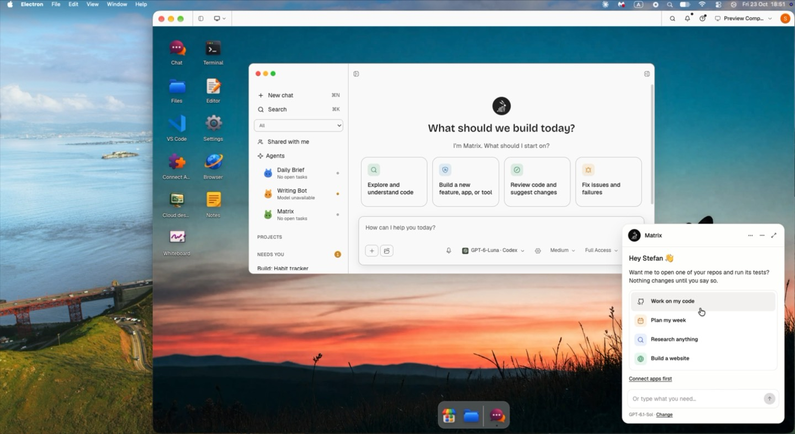
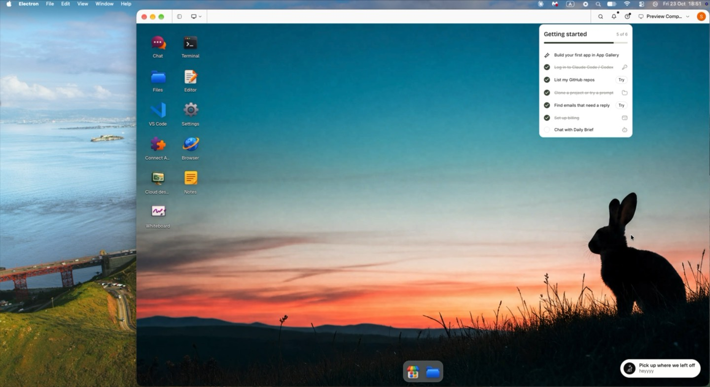
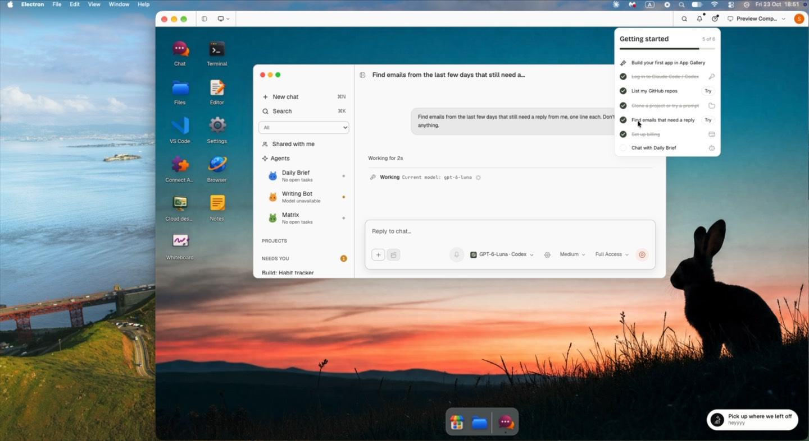

# ENG-366 Get started: live evidence

GitHub stack #2849 ([#2846](https://github.com/HamedMP/matrix-os/pull/2846) → [#2885](https://github.com/HamedMP/matrix-os/pull/2885)), [ENG-366](https://linear.app/matrix-os/issue/ENG-366/guided-onboarding-get-started-wizard-and-personalized-first-run), [spec 635](../../specs/635-guided-onboarding/spec.md).

## Electron Desktop

- **Build:** Electron Desktop dev build of `668ee66f8` (top of the stack), signed in to the stack's Private Preview. The preview's server bundle is `a523d9e`; the changes after it are app-side only.
- **Recorded:** 23 October 2026, one full run from a fresh wizard to the first Chat.
- **Left out for privacy:** account sign-in windows (Google, GitHub, Pipedream), the API key entry and Chat results. The clip cuts those parts.

[Walkthrough recording, 74 s](eng366/electron-desktop-walkthrough.mp4)

| Step | Screenshot |
| --- | --- |
| Name pre-filled from the sign-in account |  |
| Step 3: coding agents (Claude Code, Codex) and the integrations marketplace |  |
| Claude Code installs on the card; Codex shows Connected · OpenAI API key |  |
| A connected app shows a green Connected, no Add account |  |
| Apps ready with your data, added apps show a green Added |  |
| Meet your bots, waiting for a bot's sign-in |  |
| Summary |  |
| Arrival: the picked first app builds right away ("Build: Habit tracker") |  |
| Getting started follows the answers, with Try actions |  |
| Try opens Chat with the read-only prompt |  |

## Web Desktop and Web Canvas

Pending: captured on the Private Preview once it runs the stack's latest bundle.
