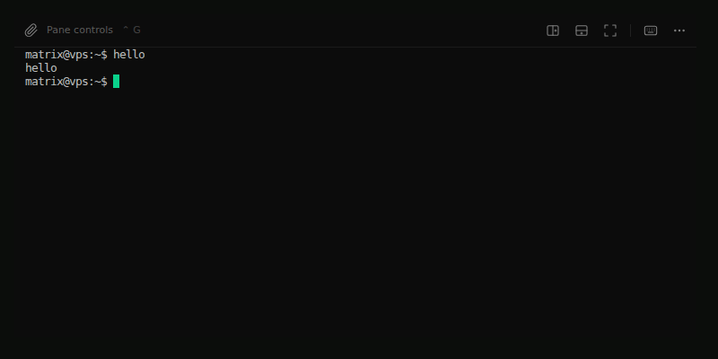

# ENG-293: modern Enter admission

Scope: key-only Enter with keyCode zero on a focused Web Terminal textarea and
trusted browser insertLineBreak with null data. Exact customer automation API
and assistive-device attribution remain unverified. Excludes ENG-294, #2599,
paste redesign, broader shortcuts and authorization changes.

A pane-local helper normalizes only these two event shapes to CR through xterm's
public input method and existing onData transport. Existing keyboard/clipboard
policy runs first. Physical Enter stays with xterm. Composition, modifiers,
malformed/untrusted input events, inactive targets and duplicate key/input phases
must not introduce CR. State and listeners are bounded and disposed on teardown.
The large TerminalPane file receives lifecycle wiring only; behavior lives in a
focused helper, avoiding further responsibility growth in that entrypoint.

Security: no endpoint/auth changes. Existing terminalRef framing, writer lease,
attachment policy, bounded gateway queue and per-delivery authorization remain
authoritative. Synthetic key-only automation is supported with a strict semantic
Enter shape on the focused textarea; arbitrary input strings are never accepted
by the helper. Browser InputEvent provenance must be isTrusted; this does not
identify the customer tool. Composition suppression persists through its final
DOM task to avoid treating IME confirmation as submission.

Validation: real Chromium + production TerminalPane/xterm, with synthetic auth
and socket transport; gateway tests execute production route callbacks for
ordered input and revocation during admission. Extend the existing Red tests,
then Green, focused regressions, typecheck, React Doctor, pattern checks and shell
production build. Recommend product/accessibility-owner review of event policy.

Surface qualification: Web Desktop/Canvas/Mobile share this pane; Electron and
Native Mobile use separate renderers and are unchanged. Do not claim live parity
from local fixtures. Current-head deployed screenshots/recordings and Slack tech
sharing are still required before merge readiness. Document the supported input
mechanisms in a separate FinnaAI/matrix-os-site content/docs PR; obtain runtime
and exact-tool evidence before claiming customer resolution.

## Evidence

Local real-Chromium capture of the production Web Terminal pane (`TerminalPane`
with real xterm, synthetic writer socket that echoes input). `hello` is typed
with the keyboard, then a key-only `keyCode=0` Enter is dispatched to the
focused textarea; exactly one `\r` input frame reaches the socket.

| Before modern Enter | After modern Enter |
| --- | --- |
|  |  |

This is a local fixture capture, not deployed-surface evidence; deployed VPS
captures for Web Desktop, Web Canvas and Web Mobile remain deferred.
