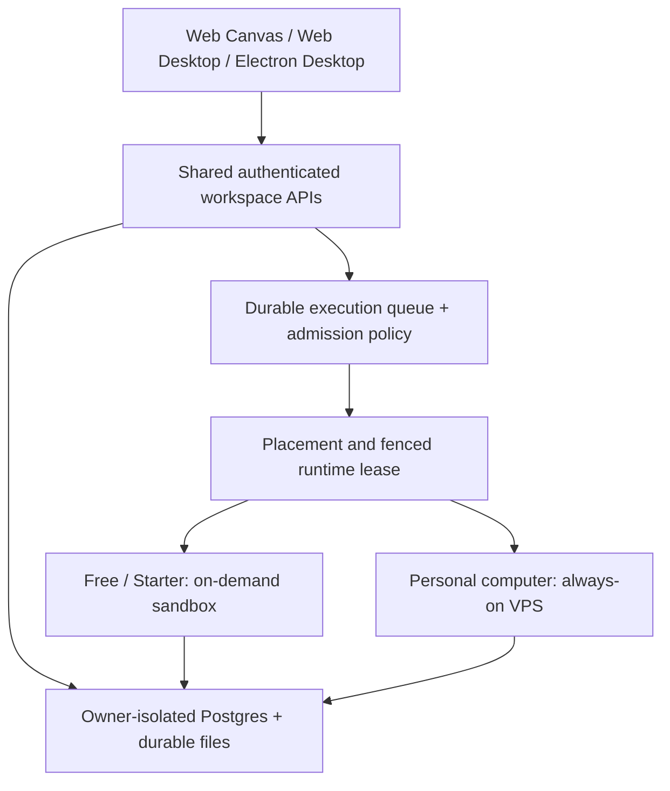

# Disposable runtimes and immediate desktop access

Date: 2026-10-18. Internal experiment; no production behavior or pricing changed.

## Decision

Support both placements behind one workspace API. Free/Starter can use ephemeral
isolated compute; Builder/Max can keep a personal computer. Users can also own
multiple workspaces/computers. Workspace identity and ownership must not depend
on a VM's hostname, IP, container ID, or placement.

Render Web Desktop from shared infrastructure immediately after authentication.
Desktop readiness and execution readiness are separate states. Do not wait for
Linux boot to show the launcher, saved layout, onboarding, or account settings.
Serve saved chats, app catalog, files and normal app data through owner-authorized
shared APIs. Start compute in the background or on the first execution action;
queue that action once and expose its truthful readiness/error state.

The synthetic benchmark validates a storage/lifecycle building block, not this
desktop experience or the existing full Matrix gateway's memory requirements.

## Current architecture boundaries

- `packages/platform/src/app-session-routes.ts` issues a runtime session using a
  machine/container handle and returns `no_runtime` when one is absent (or asks
  for billing). A free workspace session must be independent of runtime access.
- `shell/src/components/desktop/useDesktopBootstrap.ts` fetches layout, apps and
  modules through the gateway. Shared boot/data APIs are needed; showing desktop
  chrome alone would leave essential actions waiting for the sleeping gateway.
- `packages/platform/src/runtime-entitlement.ts` resolves paid machine access.
  Introduce explicit workspace and compute entitlements, not an auth bypass or
  the legacy development container router as an accidental free tier.
- Customer host config points Postgres at `127.0.0.1`; backup/restore tooling is
  machine-local. The current architecture supports recovery, not a production
  atomic checkpoint followed by intentional deletion. Hourly DB snapshots alone
  cannot guarantee preservation of the last acknowledged write.
- Existing golden images, R2 object layout, owner identity, release bundles,
  bounded provisioning jobs and runtime token generations are reusable pieces.
- Prebilling preparation currently binds a computer permanently to one owner
  and explicitly prohibits reassignment. A new allocator must reuse only clean
  capacity/images and fresh isolated runtimes; never relabel an owner's machine.

## One product, two placements

This is a target architecture, not an implemented router. Keep the shared control
plane out of untrusted execution. Separate trusted account/data services from the
runtime allocator and sandbox hosts.

Common contracts should include:

- `workspaceId`, owner scope, region and durable data identity;
- placement (`pooled` or `personal`) and a distinct runtime generation;
- states `sleeping`, `queued`, `starting`, `ready`, `checkpointing`, `failed`;
- server-authorized capability flags, compute/AI budgets and bounded queues;
- one active writable lease per workspace, enforced in Postgres writes and token
  validation, with transaction/CAS fencing against stale workers;
- separate job and event identities so retries, wakeups and reconnects do not
  duplicate work or replay it against the wrong computer.

An account can have a personal computer and a pooled workspace at once. Two
independent writable workspaces require distinct durable namespaces. Do not mount
one writable home into two runtimes and treat eventual file sync as a lock.

For the lowest migration risk, use shared owner-isolated Postgres and durable
files for the new Free/Starter path. Preserve existing VPS-local databases until
an explicit migration is validated. Each workspace advertises its data backend
behind one API; no renderer or arbitrary user sandbox receives cross-owner DB
credentials. A shared cluster must still provide per-owner database roles,
connection caps, export/deletion and bounded resource use.

Upgrade choreography: finish/drain writes, acquire a migration lease, checkpoint,
restore or attach the same durable owner data, validate it, then atomically
switch placement/generation and revoke old credentials. Keep the previous copy
until validation succeeds. Existing user data must never be replaced with the
home template. Downgrade additionally checks storage/feature limits and cannot
silently stop background work. These are required acceptance tests, not claims
that upgrade migration has shipped in this spike.

## Functions, containers and provider choice

Use functions/Workers for authentication, data APIs, wake requests, webhook
ingestion and short queued jobs. The current Linux agent CLI, PTY and development
server workload needs a container/sandbox runtime; it cannot move unchanged into
a short-lived function. Provider feasibility and billing details are in
[providers.md](./providers.md).

Cloudflare Sandbox/Containers and Cloud Run services are credible managed
container candidates. A self-managed pool is another option if capacity and a
strong isolation boundary are proven. The Docker fixture in this spike is
trusted synthetic code on its own disposable VPS, not evidence that ordinary
shared-kernel Docker safely hosts mutually untrusted users. MicroVM operation
requires compatible virtualization hosts or a service that supplies that
boundary; nested virtualization on arbitrary cloud VPSes is not assumed.

Sleeping workspaces cannot promise running terminals, dev servers, live client
connections or persistent background bots. Shared webhook/schedule services may
queue work and wake compute within quotas. Jobs must checkpoint explicitly and
cannot rely on process memory surviving termination. Automatic sleeping must
also account for active jobs, protected uploads, writes and an intentional idle
grace rather than browser tab presence alone.

## Measurement protocol

The fixture contains a Node HTTP file API, binary file payload (1 or 16 MiB),
revisioned JSON and 1,000 PostgreSQL rows with content checksums. Seed, read and
acknowledge state; stop the file writer; dump Postgres; checksum a host-directory
checkpoint; delete both runtime containers and both named writable volumes;
create fresh containers/volumes; restore; verify exact rows/files/revision;
mutate again and verify the new acknowledged revision. Remove test resources.

The fixture has no concurrent external writers. This controlled checkpoint does
not prove application-wide transactional consistency between live filesystem
and database mutations, crash recovery, multi-tenant isolation, agent session
resumption, or handling of arbitrary user-installed services.

Images are pulled before container timing. A cold fixture time includes fresh
Postgres initialization and payload generation. Restore-to-health includes
container creation, Postgres readiness, copying files/SQL, SQL import and Node
health. Warm health measures a local HTTP round trip to a tiny endpoint.
Node RSS and Docker cgroup working-set memory are different metrics; neither is
the complete host or production Matrix footprint. Do not use them to sell a
256 MiB Matrix runtime.

The separate whole-VPS test transfers the checkpoint outside the source VPS,
deletes that VPS, creates a replacement, then restores. Its durability transport
is the operator's temporary machine over SSH, not a tested R2 upload/download.
Fresh-VM bootstrap includes package installation and image pulls and must not be
compared with a warm container start as if both used prebuilt production images.

## Recorded results

[Measured lifecycle evidence](./benchmark-evidence.json) and
[reproducible modeled cost output](./cost-evidence.json) accompany this report.

Two disposable x86 CX23 hosts in Helsinki each ran three repetitions at each
payload size: **12 recorded round trips** in total. All restored acknowledged
files, JSON revision and SQL contents exactly; all verified new writes, fresh
containers/volumes and removal of test containers/volumes. A further cross-host
experiment copied a 1 MiB checkpoint outside the source host, deleted that VPS,
created a different VPS, restored exactly, and wrote again successfully.

| Measured stage | 1 MiB file, six samples | 16 MiB file, six samples |
|---|---:|---:|
| Cold synthetic fixture ready, median | 2.186 s | 2.276 s |
| Checkpoint, median | 0.363 s | 0.423 s |
| Destroy containers and volumes, median | 0.346 s | 0.332 s |
| Restore to health, median | 2.228 s | 2.221 s |
| Restore-to-health range | 2.130–2.394 s | 2.124–2.431 s |

Cross-VPS restoration after the replacement finished bootstrap took **2.163 s**.
The two fresh VPS provision/bootstrap stages took **73.0 s and 64.9 s**, including
OS packages, Docker, Node and image downloads. They are stage measurements;
manual checkpoint transfer/gaps mean no automated end-to-end user wake time was
measured. Production golden images could change this substantially.

Post-integrity-read Node RSS snapshots were approximately **61–77 MiB**. On the
final host, Docker working-set snapshots were approximately 17–33 MiB for Node
and 24 MiB for Postgres. RSS includes mappings that Docker's cache-adjusted metric
counts differently; do not sum them or treat either as a peak. Each container had
a 256 MiB limit. This light fixture does **not** establish a viable memory limit
for Matrix, its agents, terminals or app builds.

The cost examples assume Free uses 20 five-minute tasks/month and Starter uses
60 twenty-minute tasks/month, with lifecycle and idle time specified in
`providers.md`. They are examples, not product allowances.

| Modeled compute per active account/month | Free | Starter |
|---|---:|---:|
| New CX23 per activation, whole-hour billing | $0.21 | $0.62 |
| CX33 capacity baseline, 1,000 accounts and modeled peak | $0.17 | $0.34 |
| Cloud Run request billing, 1 vCPU / 2 GiB | $0.21 | $2.19 |
| Cloudflare standard-1, assumed active CPU | $0.17 | $1.29 |

These exclude durable Postgres/files, AI, shared APIs/auth, network, redundancy,
and operations. Cloudflare also has a shared $5/month plan baseline; its compared
shape is 0.5 vCPU/4 GiB, so the row is not equal-throughput evidence. The CX33 row
requires unavailable-at-observation capacity and a separately validated sandbox;
Hetzner Cloud does not support nested KVM. A ten-account CX33 pool still costs
$9.99/month, not one hundredth of that. No production vendor winner is proven.

The experiment incurred two sub-hour CX23 allocations, modeled at **$0.0208 total
server compute**, plus separately billed IP time; this is not an invoice audit.
Both temporary VPSes, their IP allocations and the temporary SSH key were deleted
and absence verified after evidence capture. The PR checkout remains for review.

## Recommended next implementation

Build **workspace access without a computer** first, keeping the existing personal
VPS path operational. Shared services should render the desktop and serve owner
state; a queue/allocator starts a sandbox asynchronously for execution. A short,
quota-controlled background warmup after interactive login is possible, but
signup alone must not allocate perpetual compute. Keep the desktop usable when
allocation is delayed or the free execution budget is exhausted.

Then benchmark the actual compiled Matrix gateway/agent path in a managed Linux
sandbox, comparing Cloudflare Sandbox with a Cloud Run container implementation.
Use functions/Workers around that path for the shared front door and scheduling.
Do not first rewrite long-lived agent execution into Lambda-style invocations or
reintroduce the legacy shared Docker customer runtime. A self-managed pool remains
an alternative once a safe isolation layer, supply and real operating costs are
proven. A production pool is a new explicit architecture decision.

## Production follow-up gates

1. Benchmark the actual compiled gateway, terminal runtime, representative agents,
   app builds and growing owner datasets; measure idle/peak/P95 memory and wake
   with prebuilt images on managed candidates and the chosen pool host.
2. Ship authenticated shared desktop/data bootstrap, free entitlement and queued
   execution admission. Test that a brand-new owner can reach Web Desktop without
   a provisioned machine. Validate Web Canvas, Web Desktop, Electron Desktop and
   supported mobile surfaces using shared contracts and feature derivations.
3. Prove checkpoint fencing, failures before/after acknowledgment, owner isolation,
   stale lease rejection, simultaneous wake, provider timeout reconciliation,
   quota admission, resource eviction and upgrade rollback with test-first work.
4. Define endpoint auth matrix, per-action bounded Zod payloads, body limits,
   provider timeouts, generic errors, secret scoping and deletion/export policy.
5. Pilot with explicit compute/storage/AI limits and measured concurrency. Include
   paid shared infrastructure and idle pool capacity in unit economics. Update
   public docs through a separate `FinnaAI/matrix-os-site` PR before release.

No new production endpoints are introduced by this experiment. The fixture HTTP
port binds only to host loopback through Docker and uses a random per-run bearer
credential; the disposable host exposes only SSH and uses a temporary key.
