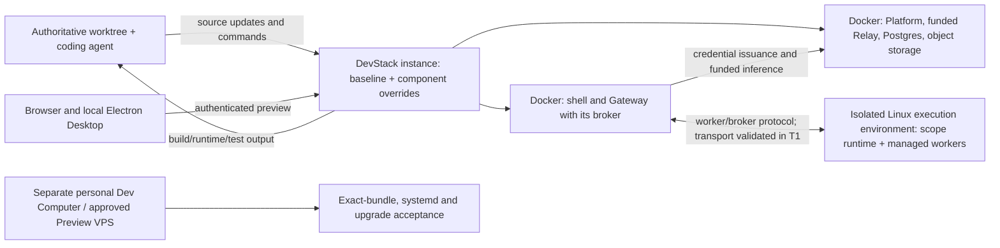

# Feature Specification: Reproducible DevStack for Multiple Worktrees

**Created**: 2026-10-30

**Status**: Draft for requirements and architecture review; not implemented

**Feature branch**: `codex/devstack-spec-20261030`

**Tracking**: [ENG-419](https://linear.app/matrix-os/issue/ENG-419/define-the-multi-worktree-devstack-specification)

**Implementation owners**: Yuhan and the coding agent

**Evidence baseline**: `main@fe208411f62dc41d0d8b3ddef0df19a9b9d4f771`

## 1. Outcome and scope

An engineer or coding agent can change uncommitted source, run the affected Matrix OS services, inspect build/runtime/test output, and receive human feedback through an authenticated preview before opening an implementation PR. Multiple worktrees and authorized engineers can use the development infrastructure concurrently.

The first delivery establishes a reproducible local development baseline. The same service/configuration contract then runs on shared Linux development infrastructure. A successful single-worktree run is an intermediate gate, not completion. The final concurrency contract is configurable **N worktrees**, not a two-worktree product limit.

The existing personal Dev Computer is already available and remains a separate host-native acceptance target. Obtaining another persistent Computer is not a prerequisite or deliverable.

### In scope

- Real authentication, runtime identity, managed Chat and tool execution, funded AI accounting, provider configuration, at least one real integration roundtrip, and persistent development data.
- One canonical service composition with local/remote placement overrides, complete source feedback, multiple worktree isolation, authenticated previews, and observable lifecycle operations.
- Configuration discovery, generated internal credentials, scoped external Dev credentials, deterministic bootstrap, and actionable preflight checks.
- Reuse of shipped staging-slot, Preview, funded-runtime and host-execution contracts where applicable.

### Out of scope

- Production customer migration to Docker; automatic Main/Dev updates or changes to existing customer identities, data, balances or subscriptions.
- An on-prem product, arbitrary autoscaling, a new scheduler, a preview dashboard, or a replacement for the managed execution engine.
- Copying production secrets or personal OAuth tokens into development, or using live production control planes as an implicit fallback.
- Provisioning resources, granting budgets, changing IAM/DNS, or running paid calls merely by approving this spec.

## 2. Current capability baseline

These are source findings at the evidence baseline, not claims of successful live acceptance.

| Area | Existing foundation | Gap addressed by this spec |
|---|---|---|
| Local services | [Dev Compose](../../docker-compose.dev.yml), Postgres, MinIO, source mounts, persistent home/dependency volumes, shell HMR and gateway watch | `full` starts the legacy proxy; real auth, dedicated funded Relay and complete configuration injection are not integrated |
| Funded Relay | [Dedicated Dockerfile](../../Dockerfile.ai-relay), funded Relay and Platform policy APIs | Wire the existing service, distinct authorities, TLS, identities, policies and accounting into DevStack |
| Worktree lifecycle | [Staging-slot runner](../../scripts/staging-slot.sh) and [slot Compose](../../docker-compose.staging-slot.yml) | Existing four-slot HMR foundation is shell/gateway oriented; extend it instead of building a second orchestrator |
| Branch execution | [Branch helper](../../scripts/branch-dev.sh) and [port overrides](../../docker-compose.branch.yml) | Some ports remain fixed; complete collision handling and mutable-state isolation are required |
| Managed execution | [Scope runtime](../../packages/scope-runtime/src/main.ts), fixed profiles and systemd launcher | Ordinary application containers do not supply the required Linux supervisor; no supported in-process development launcher is established |
| Preview | [093](../093-preview-environments/spec.md), [537](../537-private-preview/spec.md), [633](../633-preview-funded-runtime-access/spec.md) | Preserve HMR versus immutable host-bundle acceptance and reuse auth/accounting invariants without importing Preview expiry into persistent development |
| Smoke checks | [Stack smoke](../../scripts/dev-stack-smoke.mjs) | Service health alone does not establish sign-in, inference, tools, OAuth, accounting, edit feedback or concurrent worktree isolation |

[044](../044-docker-dev/spec.md) supplies historical local development scenarios; its production-Docker premise is superseded by VPS-native production. [530](../530-per-pr-preview-hostnames/spec.md) constrains isolated branch control planes; [632](../632-matrix-development/plan.md) supplies heavy-test resource constraints. This spec does not redefine those systems.

## 3. Recommended architecture

This is the recommended design, subject to the explicitly identified technical checks and team decisions below. A Docker-to-Linux managed execution bridge is work to implement and validate, not an existing capability.

For the first complete connected environment, recommend co-locating the Gateway-owned broker and managed execution within the same isolated Linux VM/worker boundary. Run the portable services with Docker there and validate protected socket, filesystem and UID mappings in T1. Do not begin by designing a remote broker protocol. Mac-only Docker remains useful for portable-service checks; it is not the full managed-execution acceptance environment.

| Component or behavior | Recommended placement | Boundary |
|---|---|---|
| Platform, dedicated funded Relay, Postgres, object storage, local TLS/ingress | Docker, first locally and then on the shared Linux host | Dev-only authorities, data and routing; same application contract in both placements |
| Shell and Gateway application code | Source-mounted Docker development services; local Electron dev server on the physical computer | Source edits must reach the correct instance without publishing a release |
| Kernel/SDK code used by managed workers | Within the selected isolated Linux execution environment | Resolve the intended worktree source/build, dependencies and native binaries; do not silently execute the installed baseline version |
| Scope supervisor and managed workers | Initially prefer a dedicated Linux VM/execution boundary; evaluate denser sharing only after isolation is proved | Preserve systemd, DynamicUser, fixed profiles, resource limits, filesystem and socket guarantees; Gateway owns the broker and T1 must validate transport across the selected boundary |
| Clerk, Cloudflare AI Gateway/upstream models, Pipedream and OAuth services | Approved external Dev projects/accounts | Actual external dependencies remain explicit; local fixtures cannot prove upstream acceptance |
| Customer installation, host bundle, native services and updates | Separate existing Dev Computer or explicitly allocated Preview VPS | Docker acceptance does not establish host-release parity |

**Technical validation T1:** prove the existing execution protocol can connect the application services and Gateway-owned broker to a selected isolated Linux environment, with the correct worktree source and native dependencies. Current host paths include a Linux x64 SDK layout; an Apple Silicon container smoke is insufficient evidence. Preserve worker network isolation and validate the transport rather than assuming the existing local sockets support remote use. Prefer reuse over a new in-process runner. If this requires excessive divergence, return with evidence and revise this section before implementation proceeds.

**Technical validation T2:** prove supervisor and worker isolation, including service discovery, cleanup, sockets, state roots, credentials and source paths. The existing systemd launcher discovers global `matrix-scope-runtime-*` units; changing a state directory alone is insufficient. Never mount the active personal Dev Computer's execution sockets into DevStack or reuse its runtime identity.

T1/T2 are engineering work owned by the implementation owners. Team decision D1 authorizes the available execution infrastructure; it does not delegate implementation to Hamed.

## 4. Configuration and bootstrap contract

Bootstrap must assemble a coherent Dev environment rather than copy a Preview/production `.env` or `host.env`. The following are existing configuration families; the implementation must trace their consumers and validate requiredness per selected capability. Names listed here are not a complete env file.

| Configuration class | Examples | Recommended source and delivery |
|---|---|---|
| Generated infrastructure configuration | DB credentials, per-instance URLs, ports, object-store namespace, local TLS trust | Generate during bootstrap; persist in restricted, ignored local files or the approved Dev secret store; inject only into consuming services |
| Control-plane authority | `PLATFORM_SECRET`, `AI_RELAY_CONTROL_TOKEN`, `AI_RELAY_METADATA_SECRET`, `AI_FUNDED_CREDENTIAL_HASH_SECRET` | Separate secrets with independent purposes; deliver to the relevant Platform/Relay services, never the browser or untrusted managed worker |
| Authentication | `NEXT_PUBLIC_CLERK_PUBLISHABLE_KEY`, `CLERK_SECRET_KEY`; internal membership/webhook configuration when required | Approved Dev Clerk application; public key supplied at shell build/dev-server time, private authority only to server consumers |
| Funded routing and upstream | `MATRIX_FUNDED_AI_CONTROL_PLANE_ENABLED`, `MATRIX_FUNDED_AI_ENABLED`, `MATRIX_FUNDED_AI_PLATFORM_URL`, `MATRIX_FUNDED_AI_RELAY_URL`, `CLOUDFLARE_AI_GATEWAY_URL`, `CLOUDFLARE_AI_GATEWAY_TOKEN` | Explicit Dev endpoints and project authority with independently agreed cost limits; keep fixture and real modes distinguishable |
| OAuth/integrations | `PIPEDREAM_CLIENT_ID`, `PIPEDREAM_CLIENT_SECRET`, `PIPEDREAM_PROJECT_ID`, `PIPEDREAM_ENVIRONMENT=development`, `PIPEDREAM_WEBHOOK_SECRET` | Approved development project and registered callbacks; each personal account connects through normal consent |
| Custom MCP, when enabled | `MCP_OAUTH_CLIENT_ID`, `MCP_OAUTH_CALLBACK_URL`, `MCP_CREDENTIAL_ENCRYPTION_KEY` | Stable Dev callback and a separate credential-encryption key; no production token import |
| Runtime identity and scoped credentials | `MATRIX_MACHINE_ID`, `MATRIX_CLERK_USER_ID`, `MATRIX_HANDLE`, `MATRIX_RUNTIME_SLOT`, `MATRIX_RUNTIME_TOKEN_EPOCH`, runtime/sync/funded/speech tokens | Issue from Dev authority for the exact owner, machine, slot, generation and purpose; never copy the current customer's values |
| Initialized database state | User projection, registered machine, entitlement, funding policy, balance, grant ledger, applicable allocation | Versioned Dev bootstrap through domain services and Postgres/Kysely; these are data, not env values |

### Required behavior

- **CFG-01:** Maintain one typed configuration manifest: variable name, capability, producer/source, service consumer, public/private classification, build/runtime phase and validation. Setting a Compose interpolation variable must not be mistaken for injecting it into a service.
- **CFG-02:** Preflight reports missing names and failed capabilities without values, credentials or private upstream errors. A healthy process with unavailable managed execution is not a fully ready stack.
- **CFG-03:** Use internal HTTPS/trusted ingress where required. The Relay's Platform-origin validator permits HTTP only for literal loopback; `http://platform:9000` does not meet that contract. The Gateway also permits `localhost`, which does not make Docker service DNS valid. Do not weaken production URL validation to make container DNS work.
- **CFG-04:** Bootstrap uses explicit Dev targets, migrations, transactions for related writes and idempotent keys. Re-running it cannot duplicate identities, grants or allocations. Partial startup has a recoverable state and owned-resource cleanup.
- **CFG-05:** Mock credentials and synthetic ledger fixtures are restricted to clearly identified offline tests. Real connected mode preserves authentication and membership policy; no insecure bypass can satisfy its acceptance gate.
- **CFG-06:** DevStack has an independent accounting authority and budget. An existing personal Dev Computer grant does not fund a local stack. No starter entitlement for an arbitrary slot or Preview allocation is assumed to appear automatically.
- **CFG-07:** Credential rotation/revocation invalidates the affected generation without changing Main or another worktree. Control-plane keys, OAuth credentials and generated secrets are excluded from source sync and evidence output.

## 5. Functional requirements

### Developer loop and surfaces

- **FR-01:** Support the complete source-edit -> run -> logs/tests -> authenticated preview -> feedback loop without requiring a commit, GitHub push, host bundle or full image build for ordinary source changes.
- **FR-02:** Cover shell, Gateway, Kernel, Platform and funded Relay. Define watch/build/restart behavior for each, plus explicit restart/rebuild semantics for configuration, lockfile and native dependency changes. Validate runtime/package-manager compatibility against the repository lockfile.
- **FR-03:** Provide agent-usable lifecycle operations for preflight, start, status, command execution, logs, tests, preview, stop, resume and explicit data reset. Reuse the slot runner and existing CLI seams; the final CLI syntax is a later implementation decision, not an existing command claim.
- **FR-04:** Every instance exposes a redacted manifest containing instance/worktree identity, placement, baseline versions, overridden components, commit and dirty-source digest, applied sync revision, endpoints, state namespace and capability status. It must be possible to detect stale source and incompatible baseline/override combinations before interpreting test results.
- **FR-05:** Web Desktop and Electron Desktop must both support real connected use. Existing applicable Web Canvas, Web Mobile and Native Mobile access must preserve the same identity/auth/data semantics. This does not add new mobile infrastructure UI; any actual platform limitation must be recorded and reviewed.
- **FR-06:** Electron development runs from source on the physical computer and connects to the intended DevStack. A browser-only test cannot stand in for Electron callback, connection and update-feedback acceptance.

### Multiple worktrees and capacity

- **FR-07:** Support N concurrent worktrees with configurable admission based on measured CPU, memory, process, storage and inference limits. N must not be hardcoded to two. The shipped four-slot runner is an initial mechanism to reuse, not a permanent product ceiling.
- **FR-08:** Allocate collision-safe instance IDs, origins and ports, including Platform, Relay, storage and callbacks. Registration/claim must be atomic; hash collisions, sanitized-name collisions and concurrent starts must fail safely or select a new available identity.
- **FR-09:** Share trusted baseline services where compatible and start only changed components per worktree. Baseline service versions are explicit. Shared services may process data only in enforced instance/owner namespaces; overrides cannot mutate baseline configuration, other worktrees or shared credentials.
- **FR-10:** Isolate mutable home, conversations, DB data, object storage, runtime identity, personal connections and accounting. Platform/schema changes require an isolated Platform database and service authority. No unqualified shared DB, home or writable AI-auth volume is accepted as worktree isolation.
- **FR-11:** Stop preserves the instance's persistent data. Reset/destruction is explicit and owned-resource scoped. Leases, TTL and crash reconciliation must not reap active sessions merely because a claim is old. Cleanup must never discover or delete another supervisor's workers or customer resources.
- **FR-12:** Apply bounded compute/inference budgets and per-instance timeouts. At capacity, return an actionable rejection without starting partial work. Releasing capacity permits later admission; choose initial limits after measurement and D1/D3.

### Source transport and shared preview

- **FR-13:** Choose one authoritative source location per worktree. Initial recommendation: authoring remains with the engineer/agent; remote execution receives a one-way source projection. Source transport includes dirty edits, explicitly selected untracked files and deletions, and excludes secrets, host dependencies, `.git` internals and generated caches.
- **FR-14:** Acknowledge applied source revisions/digests, surface interrupted sync and divergence, and never silently overwrite authoritative edits. Execute only a coherent acknowledged source state; synchronize/build native dependencies for the target OS rather than copying host `node_modules`.
- **FR-15:** Local and remote placements use the same application/configuration/lifecycle contract. Reuse suitable Matrix Sync functionality only after proving arbitrary worktree, profile and daemon isolation; never repoint an engineer's existing personal synchronization target as a shortcut.
- **FR-16:** Previews use authenticated HTTPS ingress and WebSocket support with explicit origin rules. Authorize viewers per worktree and permission level, revoke access promptly, and identify the viewed instance. Do not expose control-plane ports or reusable machine bearer tokens to viewers.
- **FR-17:** Authorizing a viewer does not grant access to the owner's personal provider/integration credentials. Personal connection consent remains owner-bound. When a coding agent performs a flow, it uses its explicitly granted capability rather than inherited host authority.

### Real functionality and accounting

- **FR-18:** Real connected mode supports normal sign-in, available model selection, streamed managed Chat, at least one tool operation, cancellation and persistence across restart. A Settings status, model catalog or endpoint health result is insufficient.
- **FR-19:** Exercise the existing authorize/check/start/release/settle/finalize accounting contract, including cancellation, provider failure, insufficient balance, concurrency rejection and retry. Keep limits enforced server-side and grants idempotent; fixtures and real upstream evidence are separate.
- **FR-20:** Verify at least one approved integration authorization and roundtrip through the Dev configuration, including callback routing, encrypted credential persistence and disconnect/revocation. Record which integration was used. Test remaining declared integrations against their own contracts before claiming universal parity.

## 6. Security and operational invariants

This spec proposes no new public endpoint paths. Any implementation that adds or changes routes must extend this matrix with exact paths and negative tests before shipping.

| Interface | Authority and allowed scope | Required negative cases |
|---|---|---|
| Agent lifecycle/exec/log operations | Authenticated developer with explicit instance ownership/access; local control endpoint is not public | Other owner/instance, stale generation, expired grant, oversized/invalid request |
| Shell preview/API/WebSocket | Approved Dev user session plus instance/view permission; explicit origin allowlist | Signed-out, forged origin/instance, revoked viewer, cross-worktree session |
| Gateway to Platform credential issuance | Purpose-scoped persistent host runtime credential bound to exact Dev machine/owner/slot/epoch | Wrong purpose/slot/epoch, disabled policy, revoked generation |
| Gateway to funded Relay inference | Short-lived Platform-issued inference credential with validated accounting context | Persistent host token presented directly to Relay, expired/forged inference token, wrong instance, exhausted limits |
| Relay to Platform control plane/upstream | Separate control/metadata authority and approved upstream Dev credentials | Runtime token presented as admin authority, forged metadata, cross-instance accounting |
| OAuth/custom MCP callbacks | Registered HTTPS callback, validated OAuth state and owner/instance-bound consent | Replayed/mismatched state, wrong instance/owner, revoked account |
| Linux supervisor and Gateway-owned broker transport | Protected transport for the selected execution boundary; any boundary-spanning transport requires explicit scoped authorization | Cross-instance socket/transport access, unit discovery/cleanup, profile escape and credential access |
| DB/object store/admin ports | Dev service identity and instance data namespace; private ingress | Cross-namespace reads/writes, untrusted runtime access to control secrets, public admin access |

All introduced inputs and URLs require boundary validation, bounded bodies/buffers, timeouts and cleanup; apply existing SSRF and redirect rules. Keep detailed errors server-side and evidence redacted. Grant-related multi-write transitions use Postgres/Kysely transactions, write-time concurrency guards and idempotent operations. Files carry configuration/source metadata; durable application/control-plane data remains in owner-scoped Postgres.

## 7. Acceptance scenarios and evidence

Implementation begins with failing contract/isolation tests, followed by real integration and surface acceptance. Each receipt records the exact source/dependency versions, mode, instance, commands, result and limitations. These are required future gates, not tests passed by this spec PR.

| ID | Scenario | Pass condition |
|---|---|---|
| A1 | Bootstrap an empty Dev target, then repeat bootstrap | Required services/identities are consistent; no duplicate grants, machines or allocations; missing configuration is actionable and redacted |
| A2 | Start real connected mode with execution service absent or misconfigured | Managed capability is truthfully unavailable; the stack is not declared fully ready and does not bypass execution/auth checks |
| A3 | Sign in and run managed Chat with a tool | Actual streamed result and independently observed tool effect, with correct owner/worktree; restart preserves conversation and allowed configuration |
| A4 | Exercise funded success, cancel, upstream failure, exhausted credit and concurrency rejection | Correct reservation/settlement/release and retry behavior in the instance's Dev ledger; no customer or other-instance balances, grants, reservations or ledger entries change |
| A5 | Complete and revoke one real integration | Correct Dev callback and owner-bound connection; roundtrip succeeds; revoked/cross-owner access is denied |
| A6 | Edit shell, Gateway, Kernel, Platform and funded Relay in turn | Correct worktree executes each change; build/runtime errors reach the agent; ordinary edits need no GitHub push/full image rebuild |
| A7 | Run at least three distinct worktrees concurrently on qualified infrastructure | Different revisions/dirty edits remain live with separate manifests, state and endpoints. Demonstrate selective reuse: e.g. Gateway override, Kernel/worker override, and Platform/Relay override against explicit compatible baseline versions. Three duplicated full stacks alone do not prove this requirement; N=3 is not a ceiling |
| A8 | Fill the configured capacity C, request C+1, release capacity and retry | Extra start is rejected without orphan work or evicting active instances; retry succeeds. Vary C independently of worktree count |
| A9 | Edit/restart/reset/crash instance A while B and C remain active | B/C data, identities, credentials, worker units, previews and ledgers are unchanged; stale cleanup remains instance-scoped |
| A10 | Override Platform/schema in one worktree; reuse compatible baseline elsewhere | Isolated migration/data/service authority; incompatible combinations fail before start, without mutating baseline or peers |
| A11 | Sync dirty/new/deleted source, interrupt and resume transfer | Remote applied digest matches authoritative source; no secret/cache transfer, partial source execution or reverse overwrite |
| A12 | Open and revoke a second authorized client's preview | Correct authenticated instance and WS behavior; unauthorized/revoked client denied; view access exposes no owner credentials |
| A13 | Repeat the development loop remotely and in Electron Desktop | Same contract and correct source/version observed; native sign-in/connection and local Electron source feedback work independently of browser success |
| A14 | Validate a relevant exact host bundle on a separate approved VPS target | Native runtime/install/update results recorded independently; no inference from Docker health and no changes to Main |

For A6/A13 measure warm edit-to-response, edit-to-UI, source-transfer and log availability latency, plus cold startup and peak resources. Proposed warm targets are under 10 seconds for application changes and under 30 seconds for Kernel/managed-worker updates on qualified infrastructure, excluding provider latency. Validate these targets in T1/T2 and record exceptions before final technical-plan approval; repeated manual restarts are not an acceptable steady-state workflow.

## 8. Delivery order and PR boundary

Local verification and PR delivery are complementary: retained repository changes need a PR even when first validated locally. This spec PR changes documentation only. It does not authorize running the future gates, creating resources or making external configuration changes.

| Step | Local/isolated validation first | Required repository delivery | External dependency |
|---|---|---|---|
| 1. Requirements and technical evidence | Audit capability/configuration gaps; bounded T1/T2 checks on authorized infrastructure | **This new spec PR**, then an evidence-backed technical plan/amendment | Team decisions below; approved Linux environment for actual execution checks |
| 2. Config/preflight and bootstrap | Generated test configuration, empty isolated DB, repeated initialization, failure recovery | **Implementation PR(s)** for schemas, templates, doctor/bootstrap and tests | Approved Dev projects/credentials and budget policy |
| 3. Integrated baseline | Compose rendering, dependency resolution, auth, internal TLS, dedicated Relay and complete connected flow | **Implementation PR(s)** for composition/images/wiring; Linux execution/isolation changes reviewed separately | Authorized real accounts and bounded upstream tests |
| 4. Complete developer feedback | Every-service source edits, errors, provenance and local Electron loop | **Implementation PR(s)** for watchers/build/lifecycle/log contracts and tests | No new cloud allocation needed for portable local checks |
| 5. N-worktree isolation | A7-A11 with configured capacity and selective overrides | **Implementation PR(s)** extending the existing slot runner and isolation tests | Qualified capacity; no assumption that an active personal VPS can host the load |
| 6. Shared remote development | Same composition, source projection, authenticated preview, A12/A13 | **Implementation PR(s)** for retained sync/ingress/CLI/skill behavior | Approved shared host, access and domain/callback configuration |
| 7. Native acceptance and documentation | Exact-version VPS receipts, recovery and operational rehearsal | Fixes as needed; repository guide plus a **separate `FinnaAI/matrix-os-site` documentation PR** under `content/docs/` | Explicitly approved acceptance target and deployment |

Actual secret values, IAM grants, DNS, external project settings and operator-created test budgets are operational configuration, not Git commits. Their templates, automation and verification logic belong in reviewed PRs. Do not publish private operator identifiers or account credentials in this public repository. Existing Preview PRs do not substitute for this new specification PR.

Suggested milestone gates:

- **M1: Reproducible complete baseline** — A1-A6 plus T1/T2; local placement is complete only with its explicitly supported Linux execution boundary. Mac-only portable checks are partial evidence.
- **M2: Multiple worktrees usable for daily development** — A7-A11, independent mutable state and no manual source/restart workarounds.
- **M3: Shared remote feedback loop** — A12/A13, access revocation, measured capacity/latency and documented operations. A14 remains required for applicable host-native changes.

## 9. Decisions to take to the team

The recommendations below provide defaults for discussion; they are not approvals. Resolve a decision before work that depends on its authority or policy. Spec review, source audit and independent local draft work can proceed meanwhile.

| ID / discussion owner | Question and recommendation | What resolution unblocks |
|---|---|---|
| **D1 — Hamed / shared infrastructure owner; Yuhan for local resources** | Which shared Linux development environment can we use, who owns it, and what compute/storage/cost envelope is approved? **Recommend** a separately allocated Dev environment, initially using a VM boundary for managed execution; do not repurpose an engineer's active Computer or assume CI capacity is available. Size from measurements, including at least three concurrent worktrees | Shared execution, capacity acceptance and remote placement. Local T1/T2 may use a separately authorized local Linux VM without waiting for a shared-host allocation; VM/namespace technical selection remains our engineering task |
| **D2 — Hamed / auth and integration project owners** | Which Dev Clerk application, Pipedream development project, Cloudflare AI Gateway/model project and callback domain are approved, and what effective permissions do we already have? **Recommend** dedicated Dev projects and narrowly scoped credentials; stable callback routing; normal personal consent. We audit existing permissions and perform configuration we are authorized to do | Real sign-in, provider/Chat and integration acceptance; only unavailable project authority/configuration needs owner assistance |
| **D3 — Hamed / budget owner** | Who funds Dev inference/integrations, with what per-instance and shared caps, real-test allowance and refill policy? **Recommend** explicit small non-renewing test grants, server-enforced per-instance plus shared limits, and no borrowing from customer balances. Do not infer a new allowance from an existing Dev Computer credit | Billable acceptance and real shared usage; fixtures may run independently |
| **D4 — Hamed / engineering access owner** | Who can start stacks, preview them, execute commands and connect personal integrations? **Recommend** developer allowlist, owner-private write/exec by default, explicitly granted viewer access and prompt revocation. Membership does not grant personal credentials | Shared preview/access policy and negative acceptance cases |
| **D5 — engineering owners** | What idle retention, storage limit and reset policy should shared Dev use? **Recommend** stop-with-data-preserved, explicit reset, bounded retained stopped data, active leases and owner notice before expiry. Preview's 72-hour lifetime must not be copied automatically | Shared lifecycle/cleanup defaults. We propose measured values in the technical plan |

No team decision is needed merely to choose field names, write preflight/bootstrap, wire existing APIs, test watchers, or investigate isolation. The implementation owners do that work and return with technical evidence. If an existing project/permission cannot meet the recommended separation, record the specific exception for review rather than silently using production authority.
