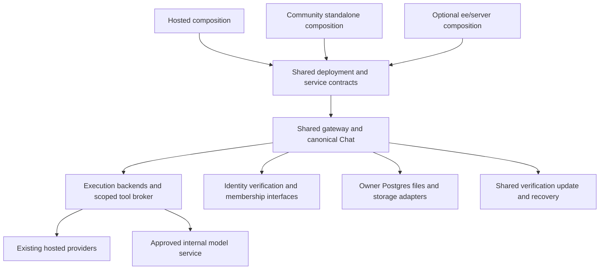

# Implementation plan: on-premises and air-gapped Matrix OS

**Branch:** `codex/639-onprem-airgap-plan` · **Date:** 2026-10-31 · **Baseline:** `231eff01cf7f67a0c135653848093c30fda3b90d`.

**Tracking:** [ENG-423](https://linear.app/matrix-os/issue/ENG-423), assigned to Hamed. Inputs: [spec.md](spec.md), [runtime research](research-runtime.md), [operations research](research-operations.md), [licensing.md](licensing.md). This is an implementation plan, not a working offline release, security certification or adopted commercial license.

## Summary and delivery claim

Develop one Matrix source line supporting hosted, standalone connected and disconnected customer deployments through explicit composition. Shared runtime, data, permission, network and update primitives stay in core. Optional enterprise administration may live under `ee/` after its legal boundary is approved. Do not copy the OS, kernel, shell or updater into EE.

Start with a Linux x86-64, single-owner web demonstrator using real local inference and synthetic data. Prove install → authenticate → local agent/tool → app build → reboot → update → restore. A read-only local Chat demo is an earlier spike, not that milestone. Multiuser enterprise and all five affected surfaces remain required before claiming full support. No surface may silently become N/A; exclusions require architectural rationale and reviewer approval.

Air-gap means no internet dependency for the declared operational period. Customer LAN services may provide inference, identity, DNS, time, package/artifact repositories, storage and collaboration. Disconnecting after online activation or cache warming is insufficient. Offline runtime installation and rebuilding all source inside the gap are separate capabilities.

## Technical context

| Item | Constraint |
|---|---|
| Runtime | Existing Node.js 24+, strict TypeScript, Hono, Next/React, Electron and Expo/native. Keep VPS-native services/bundles; no Compose-based customer runtime fork. |
| Persistence | Owner/customer-controlled PostgreSQL/Kysely for durable application/control state, inspectable files for configuration/identity exports and host update metadata. No new DB/ORM. |
| AI | Preserve existing provider adapters. Add one qualified local execution backend and shared endpoint authority; do not assume Claude SDK can transparently run local models. |
| Networking | Default-denied external traffic across host/process, browser and client boundaries; narrowly approved internal destinations. Ordinary user URL SSRF controls remain intact. |
| Identity | Single-owner strategy first; internal multiuser authority later. User authentication, authorization, runtime enrollment and entitlement are separate. |
| Capacity | OS/CPU/model/server/runtime versions, context/output limits and concurrency follow measured spikes. Earlier timing estimates are preliminary; no model-quality/hardware promise. |
| Tests | TDD with production-connected red/green fault evidence. Real model/runtime/client prerequisites fail required lanes when missing; no success by skip. |

## Constitution check

| Principle | Application and gate |
|---|---|
| Owner control | Owner Postgres/files remain canonical. Export/backup/recovery never require Matrix Cloud or paid entitlement. Personal/org state stays distinct. |
| Model independence | Preserve orchestration, tools and durable sessions; test undocumented SDK/harness behavior before committing to an adapter. |
| Headless, multiple shells | Rules live below surfaces. Each client consumes safe capability semantics; server success does not prove client parity. |
| Defense in depth | [Contracts](contracts/deployment.md) define trust hierarchy, auth/body/schema/network/resource controls before endpoints/executors are implemented. |
| TDD | Each behavior task identifies a real failing protection, implements then proves green, including failure/recovery behavior. |
| PR/worktree | Manual worktrees, requester-assigned shared ticket/stack, conventional commits, current-head Greptile 5/5 and applicable CI/evidence. Add `ready-for-ci` at 5/5. |
| Documentation | Separate `FinnaAI/matrix-os-site` PR in `content/docs/` for support matrix/install/update/restore/internal trust/client procedures. |

No principle exception is proposed. Legal clearance, model selection and runtime/device evidence are named gates, not completed checks. Recommend review by runtime, security/identity, client, release and legal owners; recommendations do not create an extra approval gate for authorized planning.

## One repository, optional EE

Dependency direction is `ee/ → shared contracts/services`. Shared packages cannot import EE, require its declarations/migrations/secrets, or probe for it via `globalThis`/reflection. Explicit composition arguments register optional implementations; absence becomes declared capability state. Core must build/run with EE physically absent.

Core retains local inference, authentication/authorization, generic OIDC/JWKS/session verification, sandbox/network enforcement, basic audit events, offline verification, backup/export/recovery and security fixes. Candidate EE scope is SSO/directory lifecycle administration, organization policy UX, audit export/compliance workflows, fleet orchestration and commercial entitlement. Basic identity/token verification is not a paid-only dependency. Hamed selected AGPL core plus public commercial/source-available EE, like PostHog. Current AGPL obligations/contributor rights still leave the lawful combination/distribution strategy unresolved; [licensing.md](licensing.md) owns that review. Folder placement or dependency injection does not resolve it, and no license terms are adopted here.

| Proposed location, not existing implementation | Responsibility |
|---|---|
| `packages/contracts/src/deployment-profile.ts` | Versioned profile/capability/authority descriptors; safe public projection. |
| `packages/contracts/src/execution-backend.ts` | Immutable owner/run/route/capability execution request/lifecycle. |
| `packages/contracts/src/offline-release.ts` | Signed inventory, compatibility/import receipt schemas. |
| `packages/gateway/src/deployment/{profile,composition,capabilities}.ts` | Profile validation and explicit permitted-service construction. |
| `packages/gateway/src/inference-endpoints/{policy,registry,transport}.ts` | Installation-owned destination/CA ceiling, scoped grants and bounded transport. |
| `packages/gateway/src/execution/{backend,local-pi-backend,background-executor}.ts` | Qualified local adapter and explicit background-purpose binding. |
| `packages/gateway/src/identity/{provider,principal-mapper}.ts` | Verified identity and immutable internal principal mapping. |
| `packages/platform/src/deployment/` | Hosted/internal authority/storage/control-plane composition; no accidental legacy orchestration. |
| `scripts/offline/{export-release.mjs,verify-release.mjs,import-release.sh}` | Connected preparation/export and disconnected verify/import using shared lifecycle. |
| `scripts/qualification/airgap/` | Clean host/process/client/network qualification and evidence export. |

Flat optional EE layout: `ee/server/composition.ts`, `ee/identity/`, `ee/admin/`, `ee/license/offline-entitlement.ts`. Establish intentional workspace/export/build/notice boundaries before executable EE code. Existing files/licenses remain unchanged by this plan.

## Profile and authority composition

Connectivity and edition are independent: community can run air-gapped; EE can run connected. Validate a versioned administrator-owned profile once at startup into immutable dependencies. Every enabled capability declares implementation, authority, credential/trust reference, network policy and safe availability. Unconfigured required infrastructure fails startup or returns safe 503-style unavailable state; deliberate optional absence is explicit unsupported state. Never guess mode from a build key or fall back to Matrix defaults.

Hosted retains current Clerk/funding/billing/provisioning/storage/release invariants. Standalone connected preserves current installer/local login. Standalone air-gap composes local owner identity, internal inference, owner data and offline lifecycle. Enterprise air-gap adds internal membership/runtime-discovery/relay and administration. Profile changes require revision checks plus controlled reload/restart; active work retains exact admitted revisions or is cancelled by revocation.

Installation operators own the global destination/CA/egress ceiling. Org admins may grant only a permitted subset to their own org; members/apps/models cannot broaden it. Role checks, revisioned grants and audited denial tests must enforce this hierarchy in services, not only UI. Internal endpoint enrollment is distinct from a user-provided web URL.

## Local execution must perform real work safely

1. **Admission:** resolve actor/owner, Chat/Bot/background purpose, explicit endpoint/model/capability and policy revision. Persist existing canonical run identity; no parallel local transcript/run DB.
2. **Transport:** gateway broker owns inference connection/credentials. Isolated workers retain denied arbitrary LAN/TCP access. Bind origin/port/path family, trust roots and addresses; pin accepted DNS resolution with TLS hostname checks. Reject redirects unless every hop is authorized; deny metadata/unrelated internal services despite one approved model server.
3. **Tools:** use scoped broker actions or an independently qualified OS sandbox for writes/subprocesses. Approved roots/actions/grants derive from persisted policy. Current generic Pi/OpenCode drivers remain read-only until broader confinement is proven. A cwd is not a sandbox.
4. **Lifecycle:** bounded stream/resources, cancellation/drain and safe errors. Advertise resume only after gateway/process-loss tests. Recover exact work without replaying uncertain effects; an uncertain write becomes an explicit reconciliation state.
5. **Credentials:** explicit none/internal-bearer/mTLS types. Keyless endpoints get a real readiness mode, not fabricated cloud credentials. Secrets stay in trusted transport; gateway/database/admin secrets never enter agent environments.
6. **Coverage:** ordinary Chat, heartbeat/healing, Bots, App AI and active historical SDK helpers must use approved local capability or declare unavailable before side effects. A Chat setting cannot leave background work on Claude or App AI on a cloud-only path.

Measure exact-version model/tool schema compatibility, structured output, streaming/cancel, context, vision if advertised, quantization, concurrency and restart behavior. Record actual edits/build artifacts, not assistant success text. Export model/tokenizer hashes/licenses. Produce a per-backend start/restart/process-loss/resume/cancel matrix, including explicit unsupported cells.

## Internal identity, discovery and collaboration

Keep configured-owner identity only in declared single-owner mode. Multiuser verification maps installation + exact issuer + subject to immutable internal actor IDs, with separate immutable org IDs. Never use email, raw subject or an issuer-controlled display claim as ownership authority. No configured-owner fallback in multiuser mode. Single-owner-to-org migration and restoration require explicit audited mapping, content/credential scope checks and rollback/recovery evidence.

An internal authority owns membership/revocation epochs, enrollment and discovery. Reuse existing collaboration proofs and role semantics through injected adapters; replace Clerk as authority instead of renaming its projection. Internal direct origins need enrolled-runtime policy because current registration rejects non-public origins. Preserve hosted public-origin restrictions.

Qualify wrong issuer/audience, same subject across issuers/installations, email reuse, issuer/key rotation, device/session replay, logout/revocation, duplicate/reordered directory events, org departure and stale authority. Membership freshness cannot be extended locally when unreachable. Revoke writable subscriptions/active tools, not only visible UI. Native clients receive scoped sessions, never an admin bearer; browser WS paths need explicit query-token allowlisting or reviewed cookie auth.

## Offline lifecycle coordination

A complete signed manifest binds source/build/profile/platform, executable/dependency/model bytes, SBOM/source/notices and compatibility. Trust roots arrive independently. Verify completeness/authenticity/path safety/disk/permissions before any installer, model custom code, lifecycle hook or migration executes.

Reuse existing updater staging/transaction/repair via local media/internal repository. UI and daemon share source/polling policy; air-gap mode never polls Matrix channels. Preserve installed provenance separately from subscription. Coordinate quiescence, DB migration, service restart, previous version retention and health under one host-scoped lock/journal. Explicit downgrade requires compatibility and operator authorization. App rollback is not DB rollback: use expand/contract compatibility or a maintenance/verified-restore procedure. Preserve protected owner home paths.

Bundle OS/database/native/Python/Node/browser/editor/agent/model dependencies and approved templates. App builds and install-on-demand resolve from exported stores/internal repositories without public fallback. Missing dependencies produce bounded actionable failures, not recurring online retries. Backup consistently covers owner DB/files/assets/config/secrets plus internal authority state; restore to a distinct clean host and measure RPO/RTO. Recovery remains usable without an EE module or valid paid license.

## Delivery dependencies and parallelism

| Gate/story | Deliverable/dependency | Independent proof |
|---|---|---|
| Foundation | Scope/rights inventory, measured spike, shared profile/execution/identity/endpoint/artifact contracts. | Hosted contract lane plus community build with EE absent; legal work parallel to technical work. |
| US1 local runtime | Local endpoint/readiness + confined write executor + all AI paths. Depends foundation; read-only spike can start earlier. | Real Chat/tool/app/background/App AI with network denied, cancellation and restart matrix. |
| US2 lifecycle | Export/install/firstboot/package closure/update/restore. Depends artifact/profile; parallel to US1. | Empty-cache install, interrupted upgrade recovery, signature rejection and second-host restore. |
| US3 internal authority | Shared identity/mapping/membership/enrollment/relay/internal storage depends on identity/profile and can run parallel to US1/US2. Publishing an optional commercial EE adapter additionally depends on the approved rights/notice and edition boundary tasks T056/T057. | Two users/two orgs, revocation and restored ownership without Clerk/Matrix fallback. |
| US4 EE/co-development | Absent-EE guard early; optional admin/entitlement after legal decision. | Same core revision in independently built hosted/community/enterprise artifacts. |
| US5 clients | Local web during US1; internal/native sessions depend on US3. | Five actual surfaces; native iOS/Android individually qualify platforms claimed supported. |
| US6 security | Continuous source/threat review then final independent audit/egress/resource/import tests. | Verified findings remediated/resolved; mandatory coverage gaps block affected release claim. |

Extract focused composition seams before parallel edits to oversized roots. Each owner consumes the same reviewed contracts and publishes compatibility tests. Re-review source drift before restacking; do not maintain a long-lived enterprise fork. [tasks.md](tasks.md) owns detailed order and native stack layers.

## CI and evidence

Mandatory independent lanes: existing hosted; connected standalone; community with `ee/` physically absent; disconnected community with real pinned model/runtime; disconnected enterprise with internal identity/storage/relay; supply-chain inventory/signature/license closure; named-surface qualification. Use frozen lockfiles in all supported source exports. Removing EE must not require undeclared stubs/secrets or bypassed dependency integrity.

Network qualification starts before installation with empty server/client caches and covers successful and failed external DNS/socket/HTTP attempts from gateway, agents/Python/native/build children, browser workers and native clients. Exercise first use, timers, token/certificate expiry, update/backup and extended disconnected periods. Mocking `fetch` or warm cached login is insufficient.

Live evidence is required for Web Canvas, Web Desktop, Web Mobile, Electron Desktop and Native Mobile. Capture exact build/scenario/OS/device plus screenshots/recordings outside the repo. Put accessible evidence in PRs and, only when explicitly authorized, Slack `#tech` with ticket/PR links and cross-linked permalink. Missing model/VM/device access blocks affected readiness. Planning-only docs have no changed running surface; implementation layers do.

## Review, stacks and release decision

Review in three explicit passes: source/all-path coverage; adversarial trust/isolation/lifecycle/licensing; execution/dependency/test/operability. Record substantive findings/resolutions in [review.md](review.md). Repeat against final source/artifact/infrastructure versions. A fixed review count or static scan does not prove absence of bugs.

Follow `docs/dev/stacked-prs.md`: independent roots/native stacks for foundation, runtime, lifecycle, internal organization, editions, clients and qualification. Each layer links ENG-423 and its stack/spec, aims below 1000 additions/20 files and splits before 3000/50. Current-head Greptile 5/5, required CI, security and actual visual evidence precede readiness. No merge/release is authorized by this plan.

Before commitments: choose measured OS/model/hardware limits; resolve lawful commercial licensing/combination; define required speech/search/connectors and native distribution; approve installation trust/key/backup custody; obtain actual qualification infrastructure. Documentation and support describe precise exclusions. Public SaaS services do not become available across a strict gap.

Further design: [data-model.md](data-model.md), [contracts/deployment.md](contracts/deployment.md). Execution/validation: [tasks.md](tasks.md), [quickstart.md](quickstart.md).
