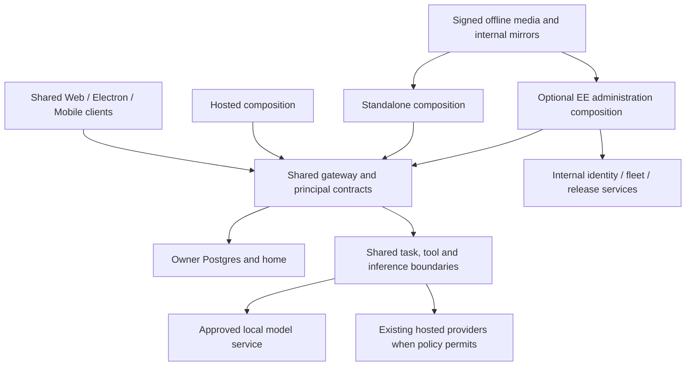

# Source-backed research and decisions

Date: 2026-10-31. Source baseline: 231eff01cf7f67a0c135653848093c30fda3b90d.
Tracking: [ENG-423](https://linear.app/matrix-os/issue/ENG-423/plan-secure-on-prem-and-air-gapped-matrix-os-with-an-optional-ee-layer).

## Method and limits

Parallel source investigations covered runtime/AI/clients and operations/distribution/storage. A separate scoped Codex Security Standard scan reviewed the provider configuration boundary. Plan review is a further activity; neither documentation review nor a source scan establishes runtime qualification.

No model was downloaded, inference benchmark executed, VM provisioned, device tested, production service changed, license adopted or external message sent by this planning work. Git main was safely refreshed before the worktree was created. Existing local/untracked work was preserved.

Evidence files:

- [Runtime and clients](research-runtime.md): production execution map, existing native model catalogs, read-only driver limitation, client startup and missing local paths.
- [Operations and distribution](research-operations.md): installers/build/first use/update, storage/backup, PKI/time, cloud control-plane coupling and CI.
- [Security design and assurance](security-plan.md): trust boundaries, adversarial acceptance and scope/limits of the completed review.
- [Licensing](licensing.md): PostHog comparison, current AGPL, options and rights gates.
- [Repeated review outcomes](review.md): planning defects found and corrected across review passes.

Line anchors in those files refer to the baseline. Proposed target paths in plan/tasks/contracts are new design, not a claim that the corresponding modules already exist.

## Architecture direction

The arrows describe composition dependencies, not unrestricted network permission. Core never imports EE implementation. Deployment profile, authenticated principal, network policy, AI source and commercial entitlement remain separate authority domains.

## Decisions and alternatives

| Decision | Evidence/rationale | Alternative considered |
| --- | --- | --- |
| One shared OS, optional composition above it | Headless packages and canonical Chat/provider contracts already exist | Forking enterprise kernel/gateway/shell would duplicate every fix and create drift |
| Reuse native Pi/OpenCode discovery; spike execution before standardizing | Generic catalogs already support native custom models, including offline Pi listing | “Add an Ollama URL” overlooks readiness, credentials, read-only tools and separate App AI/Bot paths |
| Separate confined write-capable execution milestone | Existing generic coding adapters deliberately permit read-only behavior | Broadening a launch mode without enforceable confinement would bypass current safety guarantees |
| Local execution must cover background and historical helpers | Heartbeat/self-healing use Claude-specific dispatcher; old App AI helper remains active | Changing only the visible Chat picker would leave cloud-dependent operations |
| Approved internal origins need a trusted policy | Provider URL validation currently rejects private origins, and actual inference transport has unqualified DNS/redirect behavior | Global private-IP acceptance weakens unrelated fetch/SSRF defenses |
| Internal principal authority replaces public identity projection | Organization state is a Clerk projection and collaboration has platform-owned authority | Relabeling IDs or trusting a reverse-proxy header does not establish org security |
| Air-gap packaging includes application creation and first-use assets | Installer/first boot/tool packs/package managers independently download dependencies | A prebuilt app tarball alone does not produce a usable disconnected OS |
| Qualify internal storage through a distinct composition | S3 seams exist; production hosted validation separately requires EU R2 | Changing S3_ENDPOINT alone does not produce a standalone control plane |
| Reuse release transaction behavior with authenticated local imports | Existing updater has staging/recovery/protected-path behavior | Forking a second updater risks losing data and rollback safeguards |
| Core provides basic local/security/data-portability capabilities | Existing project ownership/defense principles apply to all distributions | Putting security fixes or export behind EE would undermine usable open-source core |
| Keep legal options explicit | Matrix is AGPL; PostHog core example is MIT plus exclusions | Copying an ee/LICENSE or moving files cannot supply missing rights |
| Independent client qualification | Mobile and Electron retain different hosted identity/bootstrap requirements | Web standalone evidence cannot support native readiness claims |

## Security review performed

Codex Security Standard scan caa98082-a556-49bb-835d-0dd52af0b7b7 completed for packages/gateway/src/agent-config at source baseline 231eff01cf. The review covered 15 source files and established no reportable vulnerability within that scope. Assurance is partial: actual Hermes inference DNS pinning, redirects and credential recipient binding remain a named follow-up, not a proven exploit or a passed test.

The scan ran sequentially because the concurrent worker slots were occupied; no independent security baseline was available for that scan. No runtime probing was performed. Concurrent documentation commits changed HEAD, but the scanned source directory was unchanged from the baseline. Canonical scan output is outside the repository; its local path is provided in the chat handoff. Sensitive reports are not embedded in public specs.

Account check: TAC access granted, Daybreak programs not granted on 2026-10-31. Daybreak Blue did not run. [Daybreak access](https://chatgpt.com/cyber) is an outstanding operational prerequisite if that specific review is required. Available independent security review remains a required assurance path; tool enrollment is not proof of security.

## Open gates, rather than hidden assumptions

| Gate | Decision/evidence required | What can proceed meanwhile |
| --- | --- | --- |
| Reference environment | Supported distro/version, topology, DB deployment, model/harness, hardware and workload/performance thresholds | Documentation, dependency inventory, contract review |
| Commercial licensing | A/B/C choice, licensor and rights inventory, counsel review, component redistribution rights | Shared core work and fully AGPL option |
| Internal organization authority | IdP/issuer/trust mapping, runtime enrollment, collaboration topology and revocation contract | Single-owner core demonstrator; contract tests |
| Network/transport | Trusted endpoint registry, DNS/redirect/TLS credential binding and process/client enforcement | Negative tests and local read-only spike under blocked egress |
| Full runtime qualification | Exact produced artifacts/model, app writes/background/App AI/Bots, lifecycle and restore | Source-backed implementation tasks |
| Native and visual evidence | Web Canvas, Web Desktop, Electron Desktop, Web Mobile, Native Mobile with actual builds/devices | Web-only demonstrator; no full support claim |
| Enterprise assurance | Remaining attack surfaces, findings disposition, independent review and Daybreak if available | Threat modeling and scoped remediation |

The prior preliminary delivery estimate is superseded by this gated decomposition. Estimate implementation after reference-model, dependency-closure and legal decisions. No measured capacity, model quality parity, release deadline or full security sign-off is asserted here.
