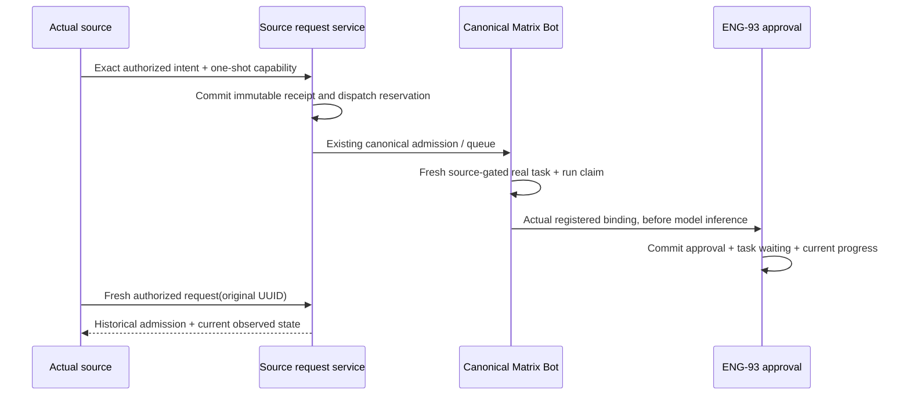

# Routine CLI interfaces

## Implementation boundary

The source/target/request/control/proposal domain ports, capability HTTP route factory and actual published CLI transport below are implemented. Production startup composition, trusted harness producers and owner UI remain subsequent increments. An injected source/runtime fixture is not an integrated harness.

Integrated ENG-93 dependency remains #3041 `e43ca79412df8562b9e12fb3a5fac3134c522170`. Future #3054 `d9e783116108d3789973cbd16fbf6795850f21a7` is not integrated. Current PR descriptions pin each B increment separately.

## Intent and identity

The authoritative strict input union is `packages/contracts/src/bots/routine-cli.ts`.

| Operation | Intent fields | Current action |
| --- | --- | --- |
| list | none | read |
| show | routineId | read |
| request | requestId | read |
| propose | requestId, proposal | propose |
| pause / resume / archive | requestId, routineId, baseRevision | control |

A mutation requestId is an explicit client UUID, scoped by configured owner+Computer. Reuse the original UUID to reconcile; changed intent conflicts. The host invocation UUID is a separate server-created identity and is never a CLI identity flag.

Proposal reuses ENG-93's strict schema: name, prompt, schedule, selection and authorizedEffects. Schedule is once/interval/cron; selection is the existing matrix_chatgpt_plan model selector. Selection/effects express requested behavior; they do not prove account, background consent or integration permission. No owner, Computer, Chat, Bot, run, runtime, account or grant override is accepted in the operation.

Internal source identity is host-created for an actual Chat run, Terminal session/incarnation/launch or offered existing Bot child. Owner+Computer, harness, generation, lifetime and eligible actions are derived from trusted context. Native Pi and managed Matrix Pi remain distinct. Plan/review/shared/org/unsupported ceilings are not overridden by remembering a target.

## Internal ports

| Port | Responsibility |
| --- | --- |
| TargetService remember/getDefault/getStoredPreference/reset | Authenticated owner routing state with CAS and exact live private direct Bot Chat checks. Stored invalid references remain recoverable. No source/action grant. |
| TargetService resolveWithin / validatePinnedWithin | Current source/target validation; duplicates and reads use the original target snapshot, not a newer default. |
| SourceService register / issue / revoke | Host-only lifecycle registration and one-shot operation-bound capability. Required actual lifecycle/action validators fail closed. No public registration/issuer endpoint. |
| SourceService consumeWithin | Consume the exact capability and execute DB-only work under its generation gate, with final current source/action checks. Rejection must escape the owning transaction. |
| SourceService validateAcceptedWithin | Revalidate consumed invocation tombstone and original source/action for actual target task claim. Token-secret cleanup does not erase accepted audit. |
| RequestService execute({token,operation}) | One strict source-only operation: canonical owning transaction, original-target policy, safe views, immutable receipt and mutation admission. Confirmed new commits alone run afterMutationCommit. |
| Canonical control adapter | Paired admitMutation/afterMutationCommit calls the same ENG-93 control core and postcommit stop path as existing callers. |
| Proposals admitMutation/afterMutationCommit | Reserve immutable proposal dispatch before canonical admitTurn can start; submit once via existing canonical continuation/admission machinery. |
| Proposals beginWithin | Verify exact stored request/hash/canonical run/turn, create a fresh real interactive target task and claim the intent in the same transaction under the original source gate. |
| Proposals consume/recover | Use the actual admitted registered binding before inference; commit pending approval+waiting task+progress atomically, or reconcile committed human work before generic abandonment. |

The real source controller must bind both request mutation/postcommit ports, the same proposal runtime object in the task orchestrator, and proposal recovery in the provider adapter. Constructor dependencies are checked when composed. No generic owner JWT proxy replaces a missing source proof.

## Proposal handoff

Reserved/queued alone does not preserve origin authority forever. Revocation/expiry winning before real task/run claim prevents handoff. After that exact one-purpose claim, normal origin completion does not erase accepted target work; actual target binding/capability/signal and ENG-93 source checks remain current.

Existing Bot-child/same-source-target reuse is an explicit unfinished adapter boundary in this increment. It fails closed instead of queuing behind itself or fabricating another binding.

## Result semantics

The CLI uses the existing v1 envelope: success `{v:1,ok:true,data}`; failure `{v:1,error:{code,message}}`. Data is validated by RoutineCliResultSchema, and errors use fixed safe vocabulary.

- receipt is immutable admission history. queued is neither pending human approval nor active.
- proposal combines the last durable handoff stage with actual current approval state and an actual standing routine, when present. The handoff may remain pending_approval after a later human decision; inspect approval and routine for that later state. Its revision belongs to the dispatch record, not independently changing approval/routine data.
- pending_approval requires a real persisted human interaction; approved alone is not a fabricated active routine.
- control applied means desired state committed. execution.stop remains unconfirmed; read current fire/review state separately.
- unknown requires reconciliation with the same UUID; not_observed means mayStillArrive, not definitely unapplied.
- Duplicate/reconciliation calls never re-admit, reroute, reactivate or redrive cancellation. No automatic mutation retry.
- Public data excludes internal source/target/runtime/task/run/interaction/account/grant references and proposal prompts.

The authority boundaries remain independent: remembered destination is routing only; current source action authority, ENG-93 human activation, background model consent and integration permissions are checked separately. The approved exact action adapter is detailed in routine-action-policy-design.md. No implementation test grants a real user operation or validates a real native account.

## Discovery, skill and acceptance handoff

Nima's capability discovery and skill work consumes the existing CLI command registration/help and the authoritative operation/result schemas exported by contracts. This task supplies routine execution and trusted source adapters, not a second discovery registry, skill implementation or documentation MCP service. The source/capability registry above authorizes actual invocations; it is not a model-facing capability catalog. Existing aliases/output stay authoritative.

C's end-to-end handoff must name exact dependency/head commits and distinguish core PostgreSQL/compiled-process, actual packaged CLI, native harness API, Terminal process proof and real-account/live lanes. Native Pi, managed Matrix Pi and offered delegated Claude are separate rows. An unqualified lane remains pending; a mock or negative-only lane does not establish a positive harness journey.

## Fixed Node CLI transport (Task3)

`@matrix-os/contracts/routine-cli` exports the original operation/proposal/result schemas and one shared strict IPC/HTTP envelope. Published `matrix`, `matrixos`, and `mos` retain the existing citty tree. `routines` accepts only the documented verbs and flags, explicit mutation UUIDs, and bounded strict proposal JSON on stdin. A profile, owner JWT, environment hint or caller identity flag never creates source context. Unknown mutation outcomes preserve the original UUID, exit75 and require a fresh authorized `request <uuid>`; no mutation is automatically retried. Human output prefers actual approval/routine state over the last handoff stage and never turns desired-state commit into stopped execution.

The fixed native invoker executes `process.execPath` plus the published `bin/matrix.mjs` and `routines` subtree, with host-configured absolute working directory/home, minimal allowlisted environment, bounded output/frames/time and an actual private fourth IPC descriptor. Only a live parent IPC channel enables the bin's bounded bidirectional JSON relay. The child sends its strict parsed operation once. Trusted host closures receive that frozen normalized operation and a new host invocation UUID, perform exact current source/action/target authorization outside DB/UI waits, then return a committed capability. An optional structured expected operation must match the child's normalized intent before authorization/issuance. Neither source identity nor capability enters argv/environment/stdout. Same-UID process inspection is not an isolation guarantee.

| Route | Authority and bounds | Owner principal |
| --- | --- | --- |
| Exact raw `POST /api/routine-cli/execute` | `Authorization: RoutineCapability rcli_…`, strict `{operation}` body, 32KiB bodyLimit before JSON, real RequestService capability consumption, 128KiB safe result | Never created |

The global auth branch is exact raw path + POST only and rejects query aliases and platform identity headers. The branch leaves ordinary auth-ready/principal context unset, blocking configured-owner fallback. The route independently requires/consumes its one-shot operation-bound capability; owner JWT/profile credentials cannot replace it. Source credentials do not authorize owner/default/grant endpoints. No public source registration/issuance endpoint, generic JWT proxy or startup wiring is installed by Task3.

Host `authorize`, `issue` and invocation-local `cancel` dependencies are mandatory and captured at construction. They must honor abort/lifecycle bounds; a late authorization/issuance result cannot be delivered to a dead child. `cancel` cleans the invocation/unused capability, never revokes the whole origin merely because the CLI exits or claims an already committed target task stopped. Later actual source producers must supply these real validators/controller callbacks; test fixture callbacks do not qualify native harness support. Normal human package invocation and the existing native three-pipe harness spawn port remain separate.

Task3 package evidence uses workspace-aware pinned pnpm10.33.4 packing, bundled original contracts, isolated cwd/HOME and actual lazy routine operations through the tarball bin. Public dependencies linked to the pre-existing local cache are explicitly recorded in the test/report; this is not a clean external npx/dlx install, standalone Bun IPC, native harness or live-provider qualification. The owner-default/action UI, exact action controller, source producers, startup composition and remaining five-harness/Terminal acceptance are still subsequent increments.
