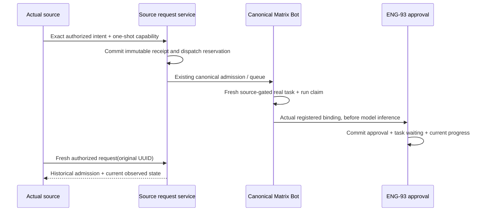

# Routine CLI interfaces

Task6b adds the [native Pi source boundary](./pi-sources.md), separately from managed Pi and native account qualification.

Task6a adds the [partial OpenCode source port](./opencode-sources.md). Its actual Matrix/CLI/Postgres lane uses named native fixtures. Production routine exposure remains closed pending the [proposed exclusive native discovery adapter](./opencode-discovery-adapter-design.md); ordinary OpenCode Chat continues unchanged.

## Implementation boundary

The source/target/request/control/proposal domain ports, capability HTTP route factory and actual published CLI transport below are implemented. Owner destination routes/startup and the shared web/native details flow are also implemented below. The bounded exact action controller and capability/request/canonical composition are implemented in Task4b. Task5a implements the actual ordinary and delegated Claude source producers described in [claude-sources.md](./claude-sources.md). Task5b implements ordinary Codex Chat and the shared private managed-launch bridge described in [codex-sources.md](./codex-sources.md), with actual systemd/native acceptance still pending. Other harness producers remain separate required work; the actual Terminal launch proof producer remains Task7 and must reuse this bridge. An injected source/runtime fixture is not an integrated harness.

Integrated ENG-93 dependency remains #3041 `e43ca79412df8562b9e12fb3a5fac3134c522170`. Future #3054 `d9e783116108d3789973cbd16fbf6795850f21a7` is not integrated. Current PR descriptions pin each B increment separately.

## Intent and identity

The authoritative strict input union is `packages/contracts/src/bots/routine-cli.ts`.

| Operation | Intent fields | Current action |
| --- | --- | --- |
| list | none | read |
| show | routineId | read |
| request | requestId | read |
| propose | requestId, proposal | propose |
| pause / resume / archive | requestId, routineId, baseRevision | control |

A mutation requestId is an explicit client UUID, scoped by configured owner+Computer. Reuse the original UUID to reconcile; changed intent conflicts. The host invocation UUID is a separate server-created identity and is never a CLI identity flag.

Proposal reuses ENG-93's strict schema: name, prompt, schedule, selection and authorizedEffects. Schedule is once/interval/cron; selection is the existing matrix_chatgpt_plan model selector. Selection/effects express requested behavior; they do not prove account, background consent or integration permission. No owner, Computer, Chat, Bot, run, runtime, account or grant override is accepted in the operation.

Internal source identity is host-created for an actual Chat run, Terminal session/incarnation/launch or offered existing Bot child. Owner+Computer, harness, generation, lifetime and eligible actions are derived from trusted context. Native Pi and managed Matrix Pi remain distinct. Plan/review/shared/org/unsupported ceilings are not overridden by remembering a target.

## Internal ports

| Port | Responsibility |
| --- | --- |
| TargetService remember/getDefault/getStoredPreference/reset | Authenticated owner routing state with CAS and exact live private direct Bot Chat checks. Stored invalid references remain recoverable. No source/action grant. |
| TargetService resolveWithin / validatePinnedWithin | Current source/target validation; duplicates and reads use the original target snapshot, not a newer default. |
| SourceService register / issue / revoke | Host-only lifecycle registration and one-shot operation-bound capability. Required actual lifecycle/action validators fail closed. No public registration/issuer endpoint. |
| SourceService consumeWithin | Consume the exact capability and execute DB-only work under its generation gate, with final current source/action checks. Rejection must escape the owning transaction. |
| SourceService validateAcceptedWithin | Revalidate consumed invocation tombstone and original source/action for actual target task claim. Token-secret cleanup does not erase accepted audit. |
| RequestService execute({token,operation}) | One strict source-only operation: canonical owning transaction, original-target policy, safe views, immutable receipt and mutation admission. Confirmed new commits alone run afterMutationCommit. |
| Canonical control adapter | Paired admitMutation/afterMutationCommit calls the same ENG-93 control core and postcommit stop path as existing callers. |
| Proposals admitMutation/afterMutationCommit | Reserve immutable proposal dispatch before canonical admitTurn can start; submit once via existing canonical continuation/admission machinery. |
| Proposals beginWithin | Verify exact stored request/hash/canonical run/turn, create a fresh real interactive target task and claim the intent in the same transaction under the original source gate. |
| Proposals consume/recover | Use the actual admitted registered binding before inference; commit pending approval+waiting task+progress atomically, or reconcile committed human work before generic abandonment. |

The real source controller must bind both request mutation/postcommit ports, the same proposal runtime object in the task orchestrator, and proposal recovery in the provider adapter. Constructor dependencies are checked when composed. No generic owner JWT proxy replaces a missing source proof.

## Proposal handoff

Reserved/queued alone does not preserve origin authority forever. Revocation/expiry winning before real task/run claim prevents handoff. After that exact one-purpose claim, normal origin completion does not erase accepted target work; actual target binding/capability/signal and ENG-93 source checks remain current.

Task5a permits existing Bot-child/same-source-target reuse only for the actual live parent registry/task/run/runtime/generation/private capability match. The existing `A.proposeWithin`, exact task waiting transition, outbox and immutable pending receipt share one transaction. A committed direct pending receipt does not resubmit a canonical turn. Current progress explicitly identifies `existingBinding: true` and observes real approval/routine state without inventing a dispatch revision. Missing or mismatched parents remain denied.

## Result semantics

The CLI uses the existing v1 envelope: success `{v:1,ok:true,data}`; failure `{v:1,error:{code,message}}`. Data is validated by RoutineCliResultSchema, and errors use fixed safe vocabulary.

- receipt is immutable admission history. queued is neither pending human approval nor active.
- proposal combines the last durable handoff stage with actual current approval state and an actual standing routine, when present. The handoff may remain pending_approval after a later human decision; inspect approval and routine for that later state. Its revision belongs to the dispatch record, not independently changing approval/routine data.
- pending_approval requires a real persisted human interaction; approved alone is not a fabricated active routine.
- control applied means desired state committed. execution.stop remains unconfirmed; read current fire/review state separately.
- unknown requires reconciliation with the same UUID; not_observed means mayStillArrive, not definitely unapplied.
- Duplicate/reconciliation calls never re-admit, reroute, reactivate or redrive cancellation. No automatic mutation retry.
- Public data excludes internal source/target/runtime/task/run/interaction/account/grant references and proposal prompts.

The authority boundaries remain independent: remembered destination is routing only; current source action authority, ENG-93 human activation, background model consent and integration permissions are checked separately. The approved exact action adapter is detailed in routine-action-policy-design.md. No implementation test grants a real user operation or validates a real native account.

## Discovery, skill and acceptance handoff

Nima's capability discovery and skill work consumes the existing CLI command registration/help and the authoritative operation/result schemas exported by contracts. This task supplies routine execution and trusted source adapters, not a second discovery registry, skill implementation or documentation MCP service. The source/capability registry above authorizes actual invocations; it is not a model-facing capability catalog. Existing aliases/output stay authoritative.

C's end-to-end handoff must name exact dependency/head commits and distinguish core PostgreSQL/compiled-process, actual packaged CLI, native harness API, Terminal process proof and real-account/live lanes. Native Pi, managed Matrix Pi and offered delegated Claude are separate rows. An unqualified lane remains pending; a mock or negative-only lane does not establish a positive harness journey.

## Fixed Node CLI transport (Task3)

`@matrix-os/contracts/routine-cli` exports the original operation/proposal/result schemas and one shared strict IPC/HTTP envelope. Published `matrix`, `matrixos`, and `mos` retain the existing citty tree. `routines` accepts only the documented verbs and flags, explicit mutation UUIDs, and bounded strict proposal JSON on stdin. A profile, owner JWT, environment hint or caller identity flag never creates source context. Unknown mutation outcomes preserve the original UUID, exit75 and require a fresh authorized `request <uuid>`; no mutation is automatically retried. Human output prefers actual approval/routine state over the last handoff stage and never turns desired-state commit into stopped execution.

The fixed native invoker executes `process.execPath` plus the published `bin/matrix.mjs` and `routines` subtree, with host-configured absolute working directory/home, minimal allowlisted environment, bounded output/frames/time and an actual private fourth IPC descriptor. Only a live parent IPC channel enables the bin's bounded bidirectional JSON relay. The child sends its strict parsed operation once. Trusted host closures receive that frozen normalized operation and a new host invocation UUID, perform exact current source/action/target authorization outside DB/UI waits, then return a committed capability. An optional structured expected operation must match the child's normalized intent before authorization/issuance. Neither source identity nor capability enters argv/environment/stdout. Same-UID process inspection is not an isolation guarantee.

| Route | Authority and bounds | Owner principal |
| --- | --- | --- |
| Exact raw `POST /api/routine-cli/execute` | `Authorization: RoutineCapability rcli_…`, strict `{operation}` body, 32KiB bodyLimit before JSON, real RequestService capability consumption, 128KiB safe result | Never created |

The global auth branch is exact raw path + POST only and rejects query aliases and platform identity headers. The branch leaves ordinary auth-ready/principal context unset, blocking configured-owner fallback. The route independently requires/consumes its one-shot operation-bound capability; owner JWT/profile credentials cannot replace it. Source credentials do not authorize owner/default/grant endpoints. No public source registration/issuance endpoint, generic JWT proxy or startup wiring is installed by Task3.

Host `authorize`, `issue` and invocation-local `cancel` dependencies are mandatory and captured at construction. They must honor abort/lifecycle bounds; a late authorization/issuance result cannot be delivered to a dead child. `cancel` cleans the invocation/unused capability, never revokes the whole origin merely because the CLI exits or claims an already committed target task stopped. Later actual source producers must supply these real validators/controller callbacks; test fixture callbacks do not qualify native harness support. Normal human package invocation and the existing native three-pipe harness spawn port remain separate.

Task3 package evidence uses workspace-aware pinned pnpm10.33.4 packing, bundled original contracts, isolated cwd/HOME and actual lazy routine operations through the tarball bin. Public dependencies linked to the pre-existing local cache are explicitly recorded in the test/report; this is not a clean external npx/dlx install, standalone Bun IPC, native harness or live-provider qualification. Task4a/4b now provide the owner destination/action UI and common source/action startup composition. Actual source producers and remaining five-harness/Terminal acceptance remain subsequent increments.

## Owner destination UI and HTTP (Task4a)

The owner opens an existing private recipe Bot Chat, then **Details → Routine destination → Use this Chat** (Native Mobile: the agent's details sheet). This explicitly remembers this Chat on the current Computer for all five harnesses. A valid saved destination needs no repeated picker; another eligible Chat's Details can change it. Clear destination resets the routing reference. Invalid stored references remain visible/recoverable; the same Bot/Chat with a replaced binding must be explicitly selected again.

| Route | Authentication / scope | Body | Public |
| --- | --- | --- | --- |
| `GET /api/routine-cli/destination` | Ordinary owner auth; actual validated RequestPrincipal.userId in bounded startup configured owner IDs + current Computer | none; no identity query filters | No |
| `POST /api/routine-cli/destination` | Same owner auth + exact live private/direct/recipe/binding checks | strict `{botId,chatId,baseRevision}`, 2KiB bodyLimit | No |
| `POST /api/routine-cli/destination/reset` | Same owner auth + revision CAS; invalid refs can be cleared | strict `{baseRevision}`, 2KiB bodyLimit | No |

The shared `@matrix-os/contracts/routine-destination` response is `{preference,availability}`; availability is unset/available/unavailable. `TargetService.getOwnerView` reads stored metadata and current availability under one preference lock/revision. Only known target_unavailable becomes the recoverable unavailable state. Database/config/auth failures remain errors, never empty defaults. `createRoutineCliDestinationService` captures at most two validated/deduplicated trusted startup IDs (`MATRIX_USER_ID` and `MATRIX_CLERK_USER_ID`) and the current Computer. It selects a separate owner scope using only the actual validated principal.userId, matching existing Bot/Chat persistence; it never rewrites one identity into another or merges their preferences/data. Foreign principals remain denied. It uses actual owner-local Chat ACL checks and installs no source/action validator or grant. Missing/invalid owner/Computer configuration is explicit503 feature unavailability. Required DB/agent/route dependencies are checked when composing. Later source/controller composition must consistently use the actual admitted owner, not assume the runtimeOwnerId label identifies every stored private Bot.

These routes have no source-token exemption; a RoutineCapability cannot edit/read owner preferences. No CLI/model owner/Computer/Chat selector fallback or public issuer is added. Changing destination never approves a routine/action, enables background models, grants app access or moves an already accepted receipt/task.

Web Canvas, Web Desktop, Electron Desktop and Web Mobile reach the shared BotChatPanel → BotDetailsPanel → RoutineDestinationSection with the actual opened Chat. Native Mobile's actual agents/[agentId] route passes its real Chat ID and detail Computer gateway to AgentDetailsSheet and a native section. Both renderers use the same pure copy/derivation and scoped async hook via `@matrix-os/ui/routine-destination`; renderer primitives differ. Client/owner/Chat/gateway changes abort outstanding work and reject late callbacks, including A→B→A. Unmount deactivates retained callbacks before they can start another read/write. Native Mobile also fences Clerk sessionId changes even when userId/getToken identity stay stable, preventing an old awaiting-token callback from dispatching. Pending same-render writes deduplicate. CAS conflicts refresh metadata without replaying intent; unconfirmed writes keep the known selection visible and require refresh. A failed initial read says unavailable, never falsely unset. Loading/disabled/error/recovery copy is shared, and explicitly says routing authorizes no operations/background/app access.

Qualification is source/component/client/owner HTTP + native PostgreSQL, including actual Native Mobile sheet and route Jest renders. No interactive GUI/device/native-provider acceptance is inferred. The common exact action approval/controller is implemented in Task4b below; trusted source execution startup/adapters, existing-target binding reuse and all-five live acceptance remain unfinished. Separate site-repository docs remain Task8.

## Exact owner action authority (Task4b)

`routine-action-source-registry.ts` accepts trusted internal producer closures only: actual source context/generation, current effective policy/origin ceiling, bounded local/DB lifecycle validator, original source signal and an actual Chat publisher when applicable. It installs no native producer, HTTP registration, MCP backend, agent identity selector, Bash or filesystem permission. Startup's empty registry is a real fail-closed state. Native Pi and managed Matrix Pi retain distinct source routes; Terminal carries its real session/incarnation/launch and never receives a synthetic Chat or Bot binding.

`routine-action-controller.ts` prepares strict operation + host invocation + original receipt target (or current new-request default) + exact binding/preference + current policy fingerprint. Personal default-interaction full_access with a proven full origin ceiling permits that exact normalized operation; supervised/auto/accept-edits and Terminal require an exact one-operation decision. Plan/review/shared/org/unsupported/read-only origin ceilings cannot be upgraded by a card. Task5/6 producers must pass the effective cross-hop ceiling; an admitted full_access row alone does not establish owner origin.

UI/proof waits hold no source/DB transaction. After proof verification, the same local source/policy and pinned target are rechecked. Issuance validates the target under the source gate; consumption preserves the established routine-before-target lock order and rejects a changed target. JSONB round trips are normalized through authoritative schemas and explicit target tuples, rather than object-key ordering. One consumed invocation can retain its exact unexpired decision after normal CLI exit while the original source remains live. Source end/policy change/decision expiry before real task claim denies; after the canonical one-purpose task claim, existing ENG-93 owns the intent independently. There is no session approval or permanent grant.

| Route | Authentication and purpose | Bounds / behavior | Public |
| --- | --- | --- | --- |
| `GET /api/routine-cli/actions` | Actual owner principal + current Computer namespace | At most128 Terminal challenges; read only | No |
| `GET /api/routine-cli/actions/:challengeId` | Same owner namespace; opaque selector is not authority | Strict challenge ID; exact owner operation/destination for review | No |
| `POST /api/routine-cli/actions/:challengeId/decision` | Ordinary owner routing auth **and** separately Platform-verified exact routine-purpose proof | Strict digest/decision/request identity;2KiB bodyLimit; no approve_for_session | No |
| `POST /api/chats/:chatId/runs/:runId/approvals/:approvalId` for `rcact_…` | Actual personal Chat/run + routine-specific submit port **before** provider submit | Preserves actionDigest; no fallback to a native/integration approval | No |
| Platform `POST /internal/containers/:handle/routine-actions/verify` | Timing-safe current-Computer transport credential plus independently signed Platform-only routine purpose |4KiB body/proof, cap8; current running authorized owner/machine/slot; verify only, never mint | No |
| Core shell `/vm/<handle>/routine-cli/confirm?runtime=<slot>&challenge=<opaque>` | Existing shell owner session; actual explicit Computer routing | GET/login/focus/browser-open reads only; explicit POST button decides | No |

The Platform mint gate positively verifies a real Clerk `sid`/owner or an unexpired signed `clerk-browser` exchange. It independently verifies a genuine Clerk cookie when a generic/device cookie won ordinary routing. Generic Sync JWT, `clerk-device`, self-claimed native clientId, device-cookie exchange, source/MCP capabilities and static/mobile routing identities cannot mint. Selected Computer ownership is checked from the trusted proxy-selected machine, not an initial legacy/default routing handle. The proof binds owner + machine ID + handle + runtime slot + challenge + exact action digest + decision + request identity + expiry under a distinct Platform-only domain/secret. `MATRIX_AUTH_TOKEN`/`UPGRADE_TOKEN` is verification transport only. Three proxy forwarding sites strip incoming purpose headers; only fresh mint output is forwarded. A legacy container with no concrete machine cannot mint.

Gateway source scopes retain at most the two configured owner IDs separately. Capability routing selects an actual issued capability's stored scope and revalidates it during consumption. Real Clerk principals work even when the runtimeOwnerId label selects another configured ID. No auth-path translation through Platform `users.id`/`clerk_id` was established: a distinct legacy/local owner namespace without proven Clerk/Computer ownership cannot receive this browser-purpose consent. It stays denied for exact-decision mutations; no alias merge or guessed mapping is installed. Self-hosted layouts omit Clerk, so the Terminal confirmation widget does not require a missing Clerk provider there; an absent Platform verifier remains an explicit unsupported decision configuration. This limitation does not confer a local-token substitute.

Web Canvas/Web Desktop share the canonical routine card and Terminal inbox. Native Mobile uses actual Clerk getToken with the same shared exact-decision hook/copy and current-Computer Terminal inbox, with Expo's streaming fetch and native secure request IDs. Electron's device-only session opens the explicit owner-browser confirmation via existing shell:open-external; its caller pins configured app origin + actual Computer descriptor/runtime + exact opaque challenge route. The pending card remains pending until observed owner decision; browser open and reopen do not approve. URLs carry no proof/token/grant/operation body. The shared card reads the exact stored intent and destination before exposing one-operation buttons and fences owner/Computer/session changes, expired/failed reads and unmounts. Approval remains separate from routine activation, background consent and integrations.

Limits: registry<=256 sources, source lifetime<=30min with recurring expiry and source/shutdown drains; controller<=128 decisions per owner and<=16/source,<=120s challenge lifetime further capped by source and<=60s owner proof; fixed network10s/4KiB verification response; recurring30s bounded secret-hash cleanup. Injected/shared repositories/pools remain caller-owned. Native Tasks5/6/7, actual accounts/providers, GUI/device acceptance and all-five end-to-end support are not established by these source/HTTP/Postgres/component fixtures. Separate site documentation remains Task8.

Task4b review tightened the shared owner-card callback boundary: every decision callback captures its rendered owner/session/Computer/challenge scope and current displayed read. Retained callbacks cannot borrow a later scope, including same-owner Clerk session replacement; unmount and scope cleanup abort token waits and browser opens. Electron Chat uses a focused scoped opener shared with the actual owner-browser helper. Opening remains navigation only, never a decision.

The shared action HTTP adapter uses portable AbortController events with a cleaned ten-second request timer covering token acquisition, fetch and bounded response reads. React Native's installed AbortSignal lacks throwIfAborted even with Expo's any/timeout patch, so this adapter does not rely on those modern helpers. Native Mobile continues to inject Expo streaming fetch and secure random request IDs. Feature-masked actual card tests and scoped token-wait tests verify this code path; they do not qualify a native device/account/provider session.

## Actual Claude source lifetime and lock ordering

The ordinary adapter execution closure and existing delegated native task service supply the admitted source identity, current generation and immutable delegated Bot/Chat ceiling. A changed default or exact owner decision cannot widen that ceiling. Native/model IDs remain correlation only.

The delegated executor invokes its host-only `onEnd` synchronously and once at first terminal result, process exit or relevant failure. Open stdio does not retain source authority. Executor completion, buffered result assembly, durable native session persistence and profile lease release still wait for actual `close`. A normal tool or CLI return does not end the actual source.

Control consumption/accepted work locks the existing routine row before source generation/source/capability gates. Consumption first rejects an invalid/replayed/expired/operation-mismatched capability, then rechecks under its original locks. All actual controller source validation acquires preference → owner gates before retained producer Chat → Run → Task locks, followed by target Chat/bindings. Remember uses preference → owner → Chat; existing canonical controls retain routine → owner/Chat. Preparation, freshness and issue do not later acquire a routine. Current-policy locks remain through commit, while owner proof/UI waits remain outside transactions. Existing canonical authorization, revision, scope and final source checks are unchanged.
